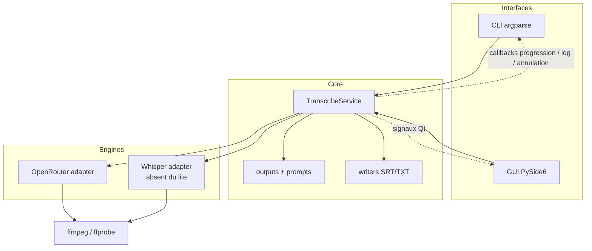

# Spécification — Whisper Transcribe Desktop, édition lite

- **Date** : 2026-11-05
- **Statut** : proposée, en attente de revue
- **Version cible** : 0.2.0
- **Périmètre** : application desktop lite multiplateforme, distribution macOS `.app` ad-hoc
- **Hors périmètre** : Whisper local dans le lite, build full, notarisation, App Store

## 1. Contexte

Le projet est aujourd'hui un CLI Python lancé avec `uv` :

```bash
uv run transcribe <fichier>
uv run transcribe --provider openrouter <fichier>
```

Il expose trois arguments (`input`, `--provider`, `--model`) et s'appuie sur deux moteurs : Whisper local et OpenRouter. Il écrit `<racine>.srt` et `<racine>.txt` à côté du fichier source, affiche une progression `rich`, demande confirmation avant écrasement et lit `OPENROUTER_API_KEY` dans l'environnement.

L'objectif est de fournir une application de bureau aux collègues qui n'ont ni Python, ni `uv`, ni `ffmpeg` installés, tout en gardant le CLI pour les développeurs. L'édition **lite** ne contient que le moteur OpenRouter afin de rester petite et de ne pas embarquer torch/Whisper. Sur macOS, elle est distribuée sans compte Apple Developer : signature ad-hoc, DMG, notice d'ouverture et SHA256.

## 2. Objectifs

- Fournir une fenêtre PySide6 sur macOS, Windows et Linux.
- Permettre de transcrire un fichier audio ou vidéo via OpenRouter sans installation Python.
- Exposer les réglages utiles : fichier, modèle, langue, prompt, dossier de sortie, formats, clé API.
- Produire exactement les mêmes fichiers SRT/TXT que le CLI pour une même entrée.
- Embarquer `ffmpeg` et `ffprobe` dans l'artefact.
- Distribuer sur macOS un `.app` signé ad-hoc, avec DMG, notice et SHA256, sans notarisation.
- Proposer un mode de distribution simple, sans installation ni droits administrateur, sur Windows (ZIP portable) et Linux (AppImage), avec un fallback respectif (installeur Inno Setup optionnel, archive tar.gz).
- Garder un artefact lite petit : pas de torch, pas de Whisper, pas de modèle local.
- Préserver le CLI et permettre plus tard un build full avec Whisper.
- Rester open-source (MIT) et reproductible via GitHub Actions.

## 3. Non-objectifs

- Whisper local dans l'édition lite.
- Build full dans cette itération.
- Notarisation Apple, Developer ID, Mac App Store.
- Mise à jour automatique, télémétrie, rapport de crash distant.
- Traitement par lot, file d'attente multi-fichiers, éditeur de sous-titres.
- Traduction, diarisation, détection de locuteurs.
- Signature Windows Authenticode.
- Paquets Linux `.deb`/`.rpm` ou dépôts de distribution.
- macOS universal2, Windows arm64, Linux arm64.
- Interface multilingue : la v1 est en français.
- Publication PyPI (le code reste installable depuis le dépôt).

## 4. Décisions de conception

| Décision | Choix | Raison |
|---|---|---|
| Framework UI | PySide6 / Qt 6 | dialogues natifs, drag & drop, threads, settings, packaging mature |
| Packaging | PyInstaller `--onedir` | compatible Qt/PySide6, plus fiable que `--onefile`, démarrage plus rapide |
| Moteur lite | OpenRouter uniquement | pas de torch, artefact petit, multiplateforme |
| Moteur Whisper | extra `[whisper]`, absent du lite | préserve le CLI sans alourdir l'artefact |
| Writers | internes au projet | supprime l'import de `whisper.utils.get_writer` |
| Signature macOS | ad-hoc (`codesign --sign -`) | aucun compte Apple Developer requis |
| Distribution macOS | DMG + ZIP + notice | gratuit, vérifiable, adapté à quelques collègues |
| Distribution Windows | ZIP portable principal ; installeur Inno Setup optionnel | mode simple sans admin ; l'installeur ajoute raccourci/désinstallation |
| Distribution Linux | AppImage principal ; tar.gz en fallback | un seul fichier, sans root ; fallback si FUSE/glibc |
| Clé API | keyring + `OPENROUTER_API_KEY` | pas de secret en clair |
| UI | français | public initial francophone |
| Tâches | une seule à la fois | évite les accès concurrents à ffmpeg et aux réglages |
| Mises à jour | manuelles via GitHub Releases | pas d'infrastructure de mise à jour |

## 5. Utilisateurs et parcours

### 5.1 Collègue non technique

1. Télécharge `whisper-transcribe-lite-macos-arm64-0.2.0.dmg`.
2. Vérifie le SHA256, ouvre le DMG, glisse l'app dans `/Applications`.
3. Au premier lancement, macOS bloque l'app ; il suit la notice : Réglages Système → Confidentialité et sécurité → « Ouvrir quand même », ou `xattr -dr com.apple.quarantine`.
4. Lance l'app, saisit sa clé OpenRouter, choisit un fichier.
5. Lance la transcription, suit la progression, ouvre le dossier de sortie.

### 5.2 Développeur

```bash
uv sync --extra gui
uv run transcribe-gui
```

### 5.3 Utilisateur du CLI

```bash
uv sync --extra whisper
uv run transcribe --provider openrouter fichier.mp4
uv run transcribe fichier.mp4          # Whisper, si l'extra est installé
```

### 5.4 Mainteneur

Pousse un tag `v0.2.0` ; GitHub Actions construit les artefacts lite, les signe ad-hoc sur macOS, calcule les SHA256 et publie la release.

## 6. Exigences fonctionnelles

| ID | Priorité | Exigence |
|---|---|---|
| FR-01 | MUST | L'application démarre sur macOS 12+, Windows 10/11 x64 et Ubuntu 22.04+ x64. |
| FR-02 | MUST | L'utilisateur peut choisir un fichier via un dialogue natif ou le glisser-déposer. |
| FR-03 | MUST | Le fournisseur OpenRouter est sélectionné par défaut ; Whisper est affiché désactivé avec la raison « non inclus dans l'édition lite » et un lien vers l'édition full. |
| FR-04 | MUST | Le modèle est un combo éditable, valeur par défaut `mistralai/voxtral-mini-transcribe-3-0`. |
| FR-05 | MUST | La langue est un combo avec `fr` par défaut et une option `Auto` ; `Auto` omet le champ `language` de la requête. |
| FR-06 | MUST | Le prompt est auto-détecté selon la priorité `.prompt.md` > `.prompt.txt` > `.prompt`, affiché en aperçu, éditable et effaçable. |
| FR-07 | MUST | Le dossier de sortie est par défaut celui de la source ; l'utilisateur peut le changer ; SRT et TXT sont cochés par défaut ; au moins un format est requis. |
| FR-08 | MUST | Avant de lancer, si un fichier de sortie existe, un dialogue liste les fichiers et demande « Écraser » ou « Annuler » ; « Annuler » ne modifie rien. |
| FR-09 | MUST | La clé OpenRouter peut être saisie, mémorisée dans le trousseau, supprimée, ou lue depuis `OPENROUTER_API_KEY` ; elle n'apparaît jamais dans les logs. |
| FR-10 | MUST | La transcription s'exécute dans un thread worker ; l'UI reste réactive ; les contrôles sont désactivés pendant l'exécution. |
| FR-10.1 | MUST | Afficher une progression visible pendant toute la tâche : phase courante, barre déterminée pour la transcription (pourcentage et position audio `mm:ss / mm:ss`), barre indéterminée pour l'extraction, la détection des silences et l'écriture, temps écoulé, et ETA lorsque calculable. La progression de la transcription avance après chaque tranche ; aucune fausse barre déterminée n'est affichée sans total connu. |
| FR-11 | MUST | Le bouton Annuler interrompt la tâche avant l'écriture finale ; aucun fichier de sortie n'est écrit ; les fichiers temporaires sont nettoyés. Pendant la phase d'écriture, Annuler est désactivé. |
| FR-12 | MUST | Les sorties SRT/TXT respectent le format exact du CLI actuel, en UTF-8 et fins de ligne LF. |
| FR-13 | MUST | Le coût OpenRouter est affiché après la transcription, avec 6 décimales ; « Coût indisponible » si l'API ne renvoie pas `usage.cost`. |
| FR-14 | MUST | Un bouton « Ouvrir le dossier » ouvre le dossier de sortie dans le gestionnaire de fichiers. |
| FR-15 | MUST | Les erreurs affichent un message utilisateur actionnable, des détails techniques et un accès au journal. |
| FR-16 | MUST | Les réglages non secrets sont persistés entre les lancements. |
| FR-17 | MUST | Un journal est écrit dans le dossier de données de l'application et affiché dans un panneau repliable. |
| FR-18 | MUST | `transcribe-gui --diagnose` produit un JSON de diagnostic et quitte sans afficher de fenêtre. |
| FR-19 | MUST | Le CLI `transcribe` conserve ses arguments et son comportement, à l'exception de l'extra `[whisper]` désormais requis pour le moteur local. |
| FR-20 | MUST | L'application n'émet aucune requête réseau hors OpenRouter ; pas de télémétrie, pas de vérification de mise à jour. |
| FR-21 | MUST | L'artefact lite ne contient ni `torch`, ni `whisper`, ni modèle local. |
| FR-22 | MUST | Sur macOS, le `.app` est signé ad-hoc, vérifiable avec `codesign --verify`, et accompagné d'une notice d'ouverture. |
| FR-23 | MUST | Chaque release publie `SHA256SUMS.txt` couvrant tous les artefacts. |
| FR-24 | MUST | GitHub Actions construit les artefacts lite pour macOS arm64, macOS x86_64, Windows x64 et Linux x64. |
| FR-25 | SHOULD | Un dialogue « À propos » affiche version, flavour, commit, date de build, licence, URL source et notices tierces. |

## 7. Exigences non fonctionnelles

| ID | Exigence |
|---|---|
| NFR-01 | Taille cible : `.app`/dossier ≤ 450 Mo décompressé ; artefact compressé ≤ 300 Mo. |
| NFR-02 | Démarrage à froid ≤ 5 s sur une machine de 2020, sans réseau. |
| NFR-03 | Aucune opération bloquante > 100 ms sur le thread UI. |
| NFR-04 | Annulation ffmpeg ≤ 2 s ; annulation réseau au plus tard à la fin de la requête en cours (timeout 90 s), avec message « Annulation en cours… ». |
| NFR-05 | Accessibilité : labels associés, navigation clavier, raccourcis, focus visible, couleurs natives Qt. |
| NFR-06 | Sécurité : HTTPS uniquement, vérification TLS standard, aucune clé dans les logs, aucun secret en clair. |
| NFR-07 | Confidentialité : l'audio est envoyé à OpenRouter ; le prompt est envoyé comme contexte lorsque le modèle le supporte ; l'UI l'indique explicitement. |
| NFR-08 | Déterminisme : mêmes segments et mêmes fichiers de sortie que le CLI pour la même réponse OpenRouter. |
| NFR-09 | Reproductibilité : `uv.lock` figé, PyInstaller épinglé, ffmpeg vérifié par SHA256. |
| NFR-10 | Licence : projet MIT ; PySide6 LGPLv3 ; ffmpeg selon le build choisi ; notices tierces fournies. |
| NFR-11 | Journal : rotation 1 Mo × 3 fichiers ; pas d'audio ni de clé dans les logs. |
| NFR-12 | Compatibilité : macOS 12+, Windows 10 21H2+/11 x64, Ubuntu 22.04+ x64. |
| NFR-13 | Les chemins avec espaces, accents et caractères non ASCII sont pris en charge. |
| NFR-14 | Une seule transcription à la fois ; un second lancement est impossible tant que la première n'est pas terminée ou annulée. |
| NFR-15 | Le binaire macOS est signé ad-hoc, mais non notarié ; la notice explique la différence. |

## 8. Architecture

### 8.1 Vue d'ensemble



Le cœur ne connaît ni Qt ni `argparse`. Il ne fait aucun `print`, ne demande aucune confirmation et n'appelle jamais `sys.exit`. Le CLI et la GUI sont deux adaptateurs du même service.

### 8.2 Arborescence cible

```text
src/whisper_transcribe/
├── __init__.py
├── core/
│   ├── __init__.py
│   ├── config.py
│   ├── models.py
│   ├── errors.py
│   ├── media.py
│   ├── prompts.py
│   ├── writers.py
│   ├── outputs.py
│   ├── service.py
│   └── engines/
│       ├── __init__.py
│       ├── base.py
│       ├── openrouter.py
│       └── whisper.py          # optionnel, jamais importé par le lite
├── cli.py
└── gui/
    ├── __init__.py
    ├── app.py
    ├── main_window.py
    ├── worker.py
    ├── settings.py
    ├── availability.py
    ├── logging_setup.py
    └── dialogs.py
packaging/
├── pyinstaller.spec
├── ffmpeg.lock.json
├── fetch_ffmpeg.py
├── sign_macos.sh
├── make_dmg.sh
├── windows.iss
├── icon.svg
└── notices/
tests/
├── test_writers.py
├── test_outputs.py
├── test_prompts.py
├── test_media.py
├── test_service.py
├── test_openrouter.py
└── gui/
    └── test_main_window.py
docs/
├── install-macos-unsigned.md
└── distribution.md
.github/workflows/build-lite.yml
```

`main.py` est supprimé ; ses fonctions migrent dans `core/` et `cli.py`. Les tests existants sont déplacés avec les fonctions concernées.

### 8.3 Contrats du cœur

#### `TranscribeRequest`

| Champ | Type | Défaut | Règle |
|---|---|---|---|
| `input_path` | `Path` | — | doit exister et être un fichier lisible |
| `provider` | `Provider` | — | `openrouter` dans le lite ; `whisper` accepté par le CLI |
| `model` | `str` | défaut du provider | non vide |
| `language` | `str \| None` | `"fr"` | `None` = Auto, champ omis de la requête |
| `prompt_text` | `str \| None` | `None` | texte déjà résolu ; `""` traité comme `None` |
| `output_dir` | `Path` | parent de la source | doit exister et être inscriptible |
| `formats` | `frozenset[OutputFormat]` | `{"srt", "txt"}` | au moins un format |
| `overwrite` | `bool` | `False` | si `False` et fichier existant → `OutputExistsError` |
| `api_key` | `str \| None` | `None` | requis pour OpenRouter |

#### `TranscribeResult`

| Champ | Type | Contenu |
|---|---|---|
| `output_paths` | `tuple[Path, ...]` | chemins réellement écrits |
| `text` | `str` | texte complet |
| `segments` | `tuple[Segment, ...]` | segments horodatés |
| `language` | `str \| None` | langue effectivement utilisée |
| `cost_usd` | `float \| None` | coût OpenRouter cumulé |
| `provider` | `Provider` | moteur utilisé |
| `model` | `str` | modèle utilisé |
| `duration_s` | `float \| None` | durée du média si connue |

`Segment` contient `id`, `start`, `end`, `text`.

#### `ProgressUpdate`

| Champ | Type | Contenu |
|---|---|---|
| `phase` | `Literal["validating", "extracting", "detecting_silences", "transcribing", "writing", "done"]` | étape courante |
| `current` | `float` | secondes audio ou tranches traitées |
| `total` | `float \| None` | total si déterminé, sinon `None` |
| `detail` | `str` | ex. « Tranche 2/3 », « Extraction audio » |

Les mises à jour sont émises à chaque changement de phase et après chaque tranche ; l'UI peut les throttler à 10 Hz maximum. Une barre déterminée n'est affichée que si `total` est connu ; sinon la barre reste indéterminée.

#### `EngineAvailability`

| Champ | Type | Contenu |
|---|---|---|
| `available` | `bool` | moteur utilisable |
| `reason` | `str \| None` | message utilisateur si indisponible |
| `detail` | `str \| None` | détail technique pour le journal |

#### `CancelToken`

- `cancel()` : idempotent, thread-safe.
- `is_cancelled() -> bool`.
- `raise_if_cancelled()` : lève `CancelledError`.

#### Callbacks

- `on_progress(update: ProgressUpdate) -> None`.
- `on_log(level: str, message: str) -> None`.

#### `DialogService`

Interface injectée dans la fenêtre pour rendre les tests non bloquants :

| Méthode | Rôle |
|---|---|
| `confirm_overwrite(paths) -> bool` | demande d'écrasement |
| `show_error(title, message, detail) -> None` | erreur avec détails |
| `show_info(title, message) -> None` | information |
| `confirm_close_while_running() -> bool` | fermeture pendant une tâche |

#### `KeyStore`

| Méthode | Rôle |
|---|---|
| `get() -> str \| None` | lit la clé (keyring ou environnement) |
| `set(key: str) -> None` | enregistre la clé dans le keyring |
| `delete() -> None` | supprime la clé |

`KeyringStore` est l'implémentation de production ; `MemoryStore` et `EnvStore` servent aux tests et au fallback. Une erreur du keyring est journalisée et ne bloque jamais le lancement.

#### Erreurs

| Classe | Usage | Message utilisateur type |
|---|---|---|
| `InvalidRequestError` | entrée, chemin, format invalide | « Choisissez un fichier audio ou vidéo. » |
| `EngineUnavailableError` | moteur absent ou clé manquante | « Whisper local n'est pas inclus dans cette édition. » |
| `MediaToolMissingError` | ffmpeg/ffprobe introuvable | « ffmpeg est introuvable ; réinstallez l'application. » |
| `OutputExistsError` | sortie existante sans écrasement | « Ces fichiers existent déjà : … » |
| `CancelledError` | annulation utilisateur | « Transcription annulée. » |
| `TranscribeError` | erreur moteur/réseau/média | message + détail |

Chaque erreur expose `user_message`, `detail` et `hint` optionnels.

### 8.4 Comportement du service

Ordre de validation :

1. `input_path` existe, est un fichier, est lisible.
2. `output_dir` existe, est un dossier, est inscriptible.
3. `formats` non vide.
4. Provider disponible.
5. Clé API présente pour OpenRouter.
6. Modèle non vide.
7. Prompt lisible si un texte est fourni.

Puis :

1. Calcule les chemins de sortie (`<stem>.srt`, `<stem>.txt`).
2. Si `overwrite=False` et qu'un chemin existe → `OutputExistsError` avec la liste.
3. Exécute le moteur avec `on_progress`, `on_log`, `CancelToken`.
4. Écrit les formats demandés en UTF-8/LF, atomiquement (fichier temporaire dans le même dossier puis `os.replace`).
5. Retourne `TranscribeResult`.

En cas d'annulation ou d'erreur avant l'écriture : aucun fichier de sortie n'est créé ou modifié. Le dossier temporaire est nettoyé dans un `finally`. L'annulation est vérifiée juste avant la phase d'écriture ; une fois celle-ci commencée, elle n'est plus interruptible et l'UI désactive Annuler. Si l'écriture d'un format échoue après le remplacement de l'autre, l'erreur indique les chemins déjà écrits.

### 8.5 Adaptateur OpenRouter

L'algorithme actuel est conservé :

- Extraction WAV 16 kHz mono via ffmpeg.
- Durée via ffprobe ; erreur si indisponible.
- Détection des silences `-35dB`, `0.4 s`.
- Coupures cibles toutes les 20 min, recherche d'un silence dans ±60 s, tranche minimale 60 s, pas de queue trop courte.
- Encodage MP3 64 kbps mono 16 kHz.
- Payload : `model`, `input_audio` base64 MP3, `language` si non nul, `response_format: "verbose_json"`, `timestamp_granularities: ["segment"]`.
- `provider.options.mistral.context_bias` si un prompt est fourni et que le modèle commence par `mistralai/`.
- Retries 3 tentatives sur 429/500/502/503/529, backoff 1/2/4 s, timeout 90 s.
- 504/524 → `ChunkTimeout` → découpage récursif en deux si la tranche dépasse 60 s.
- Décalage et renumérotation des segments.
- Somme des coûts `usage.cost` ; `cost_usd=None` si le champ est absent de toutes les réponses, `0.0` restant un coût valide.
- Si un prompt est fourni avec un modèle non-Mistral, journaliser un avertissement et ignorer le prompt.

Ajouts requis :

- `language` paramétré ; `None` omet le champ.
- Clé API injectée dans la requête, jamais lue depuis l'environnement dans l'adaptateur.
- URL injectable pour les tests ; valeur par défaut `https://openrouter.ai/api/v1/audio/transcriptions`.
- Progression : `transcribing`, `current` = secondes audio terminées, `total` = durée, `detail` = « Tranche i/n ».
- Vérification d'annulation avant chaque tranche, avant/après chaque ffmpeg, et entre les retries.
- En cas d'annulation pendant une requête HTTP, attendre la fin de la requête ou le timeout, puis lever `CancelledError`.
- Aucun log de la clé, du payload base64 ou de l'audio.

### 8.6 Couche média

`resolve_tool(name)` cherche dans cet ordre :

1. `WHISPER_TRANSCRIBE_FFMPEG_DIR` (override de développement/test).
2. Dossier `bin/` du bundle : `sys._MEIPASS/bin`, ou `Contents/Resources/bin` pour le `.app` macOS.
3. `shutil.which(name)`.
4. Réglage utilisateur (chemin explicite), si ajouté plus tard.

Les commandes utilisent :

- `Popen` avec `stdout=PIPE`, `stderr=PIPE`.
- `text=True`, `encoding="utf-8"`, `errors="replace"`.
- `creationflags=subprocess.CREATE_NO_WINDOW` sous Windows.
- Polling toutes les 100 ms pour l'annulation ; `terminate()` puis `kill()` après 2 s.
- Aucun `shell=True`.

Les fonctions `get_media_duration`, `is_video_file`, `extract_audio`, `detect_silences` et `extract_chunk_mp3` sont déplacées dans `core/media.py` et utilisent ce helper.

### 8.7 Writers

Formats exacts, alignés sur les sorties actuelles (`data/sample.srt`, `data/sample.txt`) :

- SRT :
  - index à partir de 1 ;
  - `HH:MM:SS,mmm --> HH:MM:SS,mmm` ;
  - texte du segment `strip()` ;
  - ligne vide après chaque segment ;
  - fichier terminé par une ligne vide (deux `\n` après le dernier texte).
- TXT :
  - `text.strip() + "\n"` ;
  - fichier vide si le texte est vide.
- Encodage UTF-8, fins de ligne LF sur toutes les plateformes.
- Écriture atomique via fichier temporaire + `os.replace`.
- Tests golden comparant les octets avec `data/sample.srt` et `data/sample.txt`.

### 8.8 CLI

`cli.py` reprend `argparse` avec les mêmes arguments :

- `input` positionnel.
- `--provider` : `whisper` (défaut) ou `openrouter`.
- `--model`.

Le CLI :

- résout le prompt via `core.prompts` ;
- lit `OPENROUTER_API_KEY` ;
- demande confirmation d'écrasement avec `input()` ;
- utilise `rich` pour la progression ;
- affiche les erreurs sur `stderr` et sort avec le code 1 ;
- utilise le même service et les mêmes writers que la GUI.

Whisper est déplacé dans l'extra `[whisper]`. Sans cet extra, `transcribe --provider whisper` affiche : « Moteur Whisper non installé. Lancez `uv sync --extra whisper`. » Le provider par défaut reste `whisper` ; le README documente l'extra.

### 8.9 GUI

- `QApplication` avec `setApplicationName("Whisper Transcribe")`, `setOrganizationName("whisper-transcribe")`.
- Fenêtre principale `QMainWindow`.
- Worker `QObject` déplacé dans un `QThread`.
- Signaux : `progress(object)`, `log(str)`, `finished(object)`, `failed(str, str)`, `cancelled()`.
- Le worker appelle `TranscribeService.transcribe` et mappe les exceptions vers les signaux.
- Le bouton Annuler appelle `CancelToken.cancel()`.
- Une seule tâche à la fois ; les contrôles sont désactivés pendant l'exécution.
- La fenêtre ne bloque jamais sur un dialogue depuis le worker.

## 9. Spécification de l'interface

### 9.1 Fenêtre principale

Taille minimale 760 × 640 ; géométrie mémorisée.

| Zone | Contrôles | Comportement |
|---|---|---|
| En-tête | titre « Whisper Transcribe », badge « Édition lite — OpenRouter » | fixe |
| Source | `QLineEdit` + « Parcourir… » + zone de drop | filtre audio/vidéo + tous fichiers ; valide un fichier régulier |
| Fournisseur | radio « OpenRouter (cloud) » cochée, radio « Whisper local » désactivée | Whisper affiche la raison et un lien « Édition full » |
| Modèle | `QComboBox` éditable | défaut voxtral-mini ; conserve les 5 derniers modèles |
| Langue | `QComboBox` | `fr` par défaut, `Auto`, `en`, `es`, `de`, `it`, `pt`, `nl` |
| Prompt | chemin détecté + aperçu 2 lignes + « Éditer » + « Effacer » | auto-détection ; édition dans un dialogue |
| Sortie | dossier + « Parcourir… » + cases SRT/TXT | défaut dossier source ; au moins un format |
| Clé API | `QLineEdit` mot de passe + « Mémoriser » + « Supprimer » | keyring/env ; jamais loggée |
| Avertissement cloud | texte « L'audio est envoyé à OpenRouter ; le prompt l'est si le modèle le supporte. » | visible quand OpenRouter est actif |
| Actions | « Lancer » / « Annuler » | Lancer désactivé sans fichier ; la validation complète se fait au clic ; Annuler actif hors phase d'écriture |
| Progression | barre + libellé de phase + journal repliable | indéterminée pour extraction/silences/écriture ; déterminée pour transcription avec pourcentage, position audio, temps écoulé et ETA ; avance après chaque tranche |
| Résultat | statut, coût, « Ouvrir le dossier » | après succès |

### 9.2 États

| État | UI |
|---|---|
| Vide | Lancer désactivé ; message « Choisissez un fichier ». |
| Prêt | fichier valide ; Lancer actif ; la validation complète (clé, formats, dossier) se fait au clic. |
| En cours | champs désactivés, Annuler actif, barre et journal actifs. |
| Écriture | Annuler désactivé ; barre indéterminée ; les sorties sont finalisées. |
| Annulation | libellé « Annulation en cours… », Annuler désactivé. |
| Succès | statut « Transcription terminée », chemins, coût, Ouvrir le dossier. |
| Erreur | dialogue avec message, détails, Copier le journal ; champs réactivés. |
| Annulé | statut « Transcription annulée » ; aucun fichier de sortie. |

### 9.3 Validation

- Fichier : existe, est un fichier, lisible.
- Dossier de sortie : existe, est un dossier, inscriptible.
- Formats : au moins un.
- Modèle : non vide.
- Prompt : si un fichier est auto-détecté, il doit être lisible ; sinon aucun prompt n'est utilisé.
- Clé : présente dans le champ, le keyring ou `OPENROUTER_API_KEY`.
- Provider : `EngineAvailability.available`.
- Aucun appel réseau à la validation.

La sélection d'un fichier ne lance pas `ffprobe` : la durée est déterminée dans le worker. Le dossier de sortie suit le dossier de la source tant que l'utilisateur ne l'a pas modifié ; ensuite il est conservé. L'édition du prompt modifie uniquement le texte envoyé pour la requête, pas le fichier `.prompt.*` sur disque ; une nouvelle sélection de fichier réinitialise l'aperçu sur le prompt auto-détecté.

Les erreurs de validation s'affichent en ligne sous le champ concerné, pas dans un dialogue modal, sauf pour l'écrasement.

### 9.4 Gestion de la clé API

- Service keyring : `whisper-transcribe`, utilisateur `openrouter`.
- Au démarrage : charger la clé dans le champ masqué si elle existe ; sinon laisser vide avec placeholder `OPENROUTER_API_KEY`.
- « Mémoriser » coché par défaut : enregistre dans le keyring au lancement.
- « Supprimer » efface le keyring et vide le champ.
- Si le keyring échoue : avertissement non bloquant, clé conservée en mémoire pour la session, fallback env.
- Priorité : champ non vide > keyring > `OPENROUTER_API_KEY`.
- `KeyStore` est injecté dans les settings ; les tests utilisent `MemoryStore`.
- La clé n'est jamais écrite dans `QSettings`, les logs ou les détails d'erreur.

### 9.5 Réglages persistants

| Clé `QSettings` | Type | Défaut |
|---|---|---|
| `window/geometry` | bytes | — |
| `paths/last_input_dir` | str | dossier personnel |
| `paths/output_dir` | str | vide = dossier source |
| `transcription/model` | str | `mistralai/voxtral-mini-transcribe-3-0` |
| `transcription/language` | str | `fr` |
| `output/formats` | liste | `["srt", "txt"]` |
| `api_key/remember` | bool | `true` |
| `ui/log_visible` | bool | `false` |
| `models/recent` | liste | `[]` |

### 9.6 Raccourcis et accessibilité

- `Ctrl+O` : choisir un fichier.
- `Ctrl+Entrée` : lancer.
- `Échap` : annuler la tâche en cours, sinon fermer la fenêtre.
- Labels associés aux champs (`setBuddy`).
- Ordre de tabulation logique.
- Barre de progression avec texte accessible.
- Couleurs et thème natifs Qt ; pas de thème custom en v1.

### 9.7 Diagnostic

`transcribe-gui --diagnose [--diagnose-output PATH]` :

- N'affiche aucune fenêtre.
- Écrit un JSON UTF-8 sur stdout et, si demandé, dans `PATH`, même si un outil manque.
- Quitte avec 0 si ffmpeg et ffprobe sont trouvés, 1 sinon.

Champs :

| Champ | Contenu |
|---|---|
| `app_version` | version du paquet |
| `flavor` | `lite` |
| `commit` | commit de build |
| `build_date` | date UTC |
| `python` | version Python |
| `qt` | version Qt |
| `platform` | `sys.platform` |
| `arch` | architecture |
| `frozen` | `sys.frozen` |
| `ffmpeg_path` | chemin résolu |
| `ffprobe_path` | chemin résolu |
| `ffmpeg_version` | première ligne de `ffmpeg -version` |
| `ffprobe_version` | première ligne de `ffprobe -version` |
| `whisper_available` | `false` en lite |
| `whisper_reason` | raison |
| `openrouter_model` | modèle par défaut |
| `config_dir` | dossier de configuration |
| `log_file` | chemin du journal |

### 9.8 Messages d'erreur

| Cas | Message utilisateur |
|---|---|
| Fichier absent | « Le fichier sélectionné n'existe plus. » |
| Fichier illisible | « Impossible de lire ce fichier. Vérifiez les permissions. » |
| Dossier non inscriptible | « Le dossier de sortie n'est pas inscriptible. » |
| Clé absente | « Clé OpenRouter manquante. Saisissez-la ou définissez OPENROUTER_API_KEY. » |
| Clé refusée (401) | « Clé OpenRouter refusée. Vérifiez-la dans vos réglages OpenRouter. » |
| Réseau | « OpenRouter est injoignable. Vérifiez votre connexion. » |
| Durée illisible | « Impossible de lire la durée du média. Le fichier est peut-être corrompu. » |
| ffmpeg absent | « ffmpeg est introuvable. Réinstallez l'application ou signalez le problème. » |
| Écrasement refusé | « Transcription annulée : les fichiers existants sont conservés. » |
| Annulation | « Transcription annulée. » |

## 10. Packaging lite

### 10.1 Dépendances et extras

```toml
[project]
dependencies = ["rich>=15.0.0"]

[project.optional-dependencies]
gui = [
  "PySide6-Essentials>=6.7,<7",
  "keyring>=25",
]
whisper = ["openai-whisper>=20231117"]
dev = ["pytest>=8", "pytest-qt>=4", "pyinstaller>=6"]
```

- Le lite n'installe ni Whisper ni torch.
- Le CLI Whisper nécessite `uv sync --extra whisper`.
- Le build full utilisera `.[gui,whisper]`.
- `PySide6-Essentials` limite la taille ; si un module manque, ajouter uniquement le composant PySide6 nécessaire.
- `keyring` doit embarquer son backend plateforme ; à vérifier dans l'artefact.

Entry points :

```toml
[project.scripts]
transcribe = "whisper_transcribe.cli:main"
transcribe-gui = "whisper_transcribe.gui.app:main"
```

### 10.2 PyInstaller

- Mode `--onedir`, jamais `--onefile`.
- `console=False` / `--windowed`.
- Entrée : `src/whisper_transcribe/gui/app.py`.
- Nom : `Whisper Transcribe`.
- Identifiant macOS : `io.github.whisper-transcribe`.
- Icône : `packaging/icon.svg` → `.icns`, `.ico`, `.png` générés au build.
- `info_plist` : `LSMinimumSystemVersion=12.0`, `NSHighResolutionCapable=true`, version courte et build, catégorie productivité.
- Exclusions lite : `whisper`, `torch`, `torchaudio`, `torchvision`, `numba`, `tiktoken`, `triton`, `tensorboard`, `pytest`, `tkinter`.
- Vérifier après build qu'aucun `_internal/torch`, `_internal/whisper`, `libtorch*`, `torch*.dylib` ou `torch*.so` n'est présent (le nom de l'application « Whisper Transcribe » n'est pas concerné).
- Inclure `ffmpeg` et `ffprobe` dans `bin/` du bundle, exécutables.
- Inclure `LICENSE`, `THIRD_PARTY_NOTICES.md`, `README.md`.

### 10.3 ffmpeg

- `packaging/ffmpeg.lock.json` contient, pour chaque cible (`darwin-arm64`, `darwin-x64`, `win-x64`, `linux-x64`), l'URL, le SHA256 et les chemins des binaires dans l'archive.
- `packaging/fetch_ffmpeg.py` télécharge, vérifie le SHA256, extrait `ffmpeg` et `ffprobe` dans `vendor/ffmpeg/<cible>/`.
- Aucune URL « latest » : version et hash figés.
- Préférer un build LGPL ; si le build est GPL, inclure les obligations de licence et la source correspondante dans `THIRD_PARTY_NOTICES.md`.
- Les binaires ne sont pas commités ; le CI les télécharge et les met en cache.
- Sous macOS et Linux, `chmod 755` avant signature/empaquetage.

### 10.4 macOS : signature ad-hoc et DMG

Le build produit `dist/Whisper Transcribe.app`. La signature est effectuée après PyInstaller :

1. Signer tous les fichiers Mach-O imbriqués (`.dylib`, `.so`, `ffmpeg`, `ffprobe`, exécutable Python) avec `codesign --force --sign -`.
2. Signer le `.app` en dernier avec `codesign --force --sign -`.
3. Vérifier avec `codesign --verify --deep --strict --verbose=2`.
4. Exécuter `spctl --assess --type execute --verbose=4` et **ne pas** faire échouer le build : le rejet est attendu sans notarisation.
5. Créer un dossier de staging avec :
   - `Whisper Transcribe.app` ;
   - un lien symbolique `Applications` → `/Applications` ;
   - `LIRE-MOI-macOS.txt` ;
   - `LICENSE` ;
   - `THIRD_PARTY_NOTICES.md`.
6. Créer le DMG avec `hdiutil create -format UDZO`.
7. Créer aussi un ZIP avec `ditto -c -k --keepParent`.
8. Calculer les SHA256 du DMG et du ZIP.

Contraintes :

- Signature ad-hoc uniquement ; aucun certificat Apple Developer.
- Ne pas notariser, ne pas stapler.
- Ne pas appliquer `xattr` sur l'artefact de build : c'est à l'utilisateur de retirer la quarantaine de sa copie.
- La notice doit être incluse dans le DMG et dans le ZIP.
- Le build doit être reproductible à partir du tag.

### 10.5 Windows : ZIP portable

**Mode simple principal** : le ZIP portable. L'utilisateur extrait l'archive où il veut et lance `Whisper Transcribe.exe`. Aucune installation, aucun droit administrateur, aucun runtime à installer.

- PyInstaller onedir, pas de `--onefile`.
- ZIP portable `whisper-transcribe-lite-windows-x64-0.2.0.zip`.
- L'archive contient le dossier complet `Whisper Transcribe/` avec l'exécutable, `_internal/`, `bin/ffmpeg.exe`, `bin/ffprobe.exe`, la notice et les licences.
- Installeur Inno Setup `whisper-transcribe-lite-windows-x64-0.2.0-setup.exe` : optionnel, pour un raccourci menu Démarrer et une désinstallation propre. Il n'est pas le mode principal.
- `LIRE-MOI-Windows.txt` avec la procédure SmartScreen et le SHA256.
- `CREATE_NO_WINDOW` pour tous les sous-processus.
- Tester sur Windows 10 21H2+ et Windows 11 x64.
- Vérifier qu'aucune fenêtre console n'apparaît au lancement et que le ZIP fonctionne sans admin.

### 10.6 Linux : AppImage

**Mode simple principal** : l'AppImage. Un seul fichier, `chmod +x`, double-clic ou lancement direct. Aucune installation, aucun root, aucun paquet système.

- PyInstaller onedir.
- AppImage `whisper-transcribe-lite-linux-x64-0.2.0.AppImage`.
- Archive `whisper-transcribe-lite-linux-x64-0.2.0.tar.gz` : fallback si FUSE est absent ou si le système refuse l'AppImage.
- `LIRE-MOI-Linux.txt` avec `chmod +x`, lancement, note FUSE et SHA256.
- Construire sur Ubuntu 22.04 pour maximiser la compatibilité glibc.
- Tester sur Ubuntu 22.04 et 24.04, X11 et Wayland.
- Vérifier le lancement avec `--appimage-extract-and-run` si FUSE est absent.

### 10.7 CI et release

Workflow `.github/workflows/build-lite.yml` :

- Déclencheurs : tags `v*`, `workflow_dispatch`.
- Matrice :
  - `macos-14` (arm64) ;
  - `macos-13` (x86_64) ;
  - `windows-latest` ;
  - `ubuntu-22.04`.
- Étapes :
  1. checkout ;
  2. installation de `uv` ;
  3. `uv sync --extra gui --extra dev` ;
  4. `uv run pytest` ; sous Linux, `QT_QPA_PLATFORM=offscreen` ;
  5. `uv run python packaging/fetch_ffmpeg.py` ;
  6. `uv run pyinstaller packaging/pyinstaller.spec` ;
  7. signature ad-hoc macOS ;
  8. création DMG/ZIP/AppImage ;
  9. `--diagnose` avec sortie fichier ;
  10. vérification de l'absence de torch/whisper ;
  11. calcul des SHA256 ;
  12. upload des artefacts ;
  13. release GitHub si tag.
- Aucun secret requis.
- Le job de release déclare `permissions: contents: write` pour publier la release.
- Cache `uv` et cache ffmpeg indexé par le hash de `ffmpeg.lock.json`.
- PyInstaller et les dépendances sont figés par `uv.lock`/versions.
- Les artefacts sont téléchargeables depuis la release ; aucun binaire n'est commité.

Nommage :

```text
whisper-transcribe-lite-macos-arm64-0.2.0.dmg
whisper-transcribe-lite-macos-arm64-0.2.0.zip
whisper-transcribe-lite-macos-x64-0.2.0.dmg
whisper-transcribe-lite-macos-x64-0.2.0.zip
whisper-transcribe-lite-windows-x64-0.2.0.zip
whisper-transcribe-lite-windows-x64-0.2.0-setup.exe
whisper-transcribe-lite-linux-x64-0.2.0.AppImage
whisper-transcribe-lite-linux-x64-0.2.0.tar.gz
SHA256SUMS.txt
```

### 10.8 Tailles cibles

| Artefact | Cible |
|---|---|
| `.app` / dossier Windows / dossier Linux | ≤ 450 Mo |
| DMG / ZIP / AppImage | ≤ 300 Mo |

Si la cible est dépassée : vérifier les plugins Qt, les traductions, les doublons PyInstaller et la taille du build ffmpeg. Ne pas supprimer de fonctionnalité pour atteindre la cible sans validation.

## 11. Distribution et notice

### 11.1 Modes de distribution

| OS | Mode simple principal | Fallback | Installation | Droits admin |
|---|---|---|---|---|
| macOS | DMG, glisser l'app dans `/Applications` | ZIP de l'app | aucune (déplacement) | non pour l'installation ; authentification admin pour « Ouvrir quand même » au premier lancement |
| Windows | ZIP portable, extraire et lancer `Whisper Transcribe.exe` | Installeur Inno Setup optionnel | aucune pour le ZIP | non |
| Linux | AppImage, `chmod +x` puis lancer | archive tar.gz | aucune | non |

Le mode simple est celui qui demande le moins d'étapes et ne nécessite ni Python, ni `uv`, ni `ffmpeg`, ni droits administrateur. Les fallbacks couvrent les environnements qui bloquent FUSE, les parcs Windows gérés ou les utilisateurs qui préfèrent un installeur.

### 11.2 Contenu du DMG

- `Whisper Transcribe.app`
- lien `Applications`
- `LIRE-MOI-macOS.txt`
- `LICENSE`
- `THIRD_PARTY_NOTICES.md`

`SHA256SUMS.txt` est publié comme asset de la release, pas dans le DMG : il contient le hash du DMG lui-même et ne peut donc pas y être inclus.

### 11.3 Notice macOS

Le fichier `LIRE-MOI-macOS.txt` est généré au build avec les variables `version`, `build_date`, `commit`, `tag`, `arch`, `project_url`.

```text
Whisper Transcribe — édition lite
Version {version} — build {build_date}
Commit : {commit}
Source : {project_url}

Cette application est open-source (MIT). Ce binaire n'est pas notarié par Apple,
car le projet ne dispose pas d'un compte Apple Developer payant.

INSTALLATION
1. Ouvrir le .dmg et glisser « Whisper Transcribe.app » dans /Applications.
2. Premier lancement :
   - Si macOS affiche « ... ne peut pas être ouverte », ouvrir
     Réglages Système > Confidentialité et sécurité, puis cliquer sur
     « Ouvrir quand même » et s'authentifier.
   - Ou, dans Terminal :
     xattr -dr com.apple.quarantine "/Applications/Whisper Transcribe.app"
   - Sur macOS 12 à 14, un clic droit sur l'application puis « Ouvrir »
     fonctionne généralement.
3. Vérifier l'intégrité :
   shasum -a 256 "whisper-transcribe-lite-macos-{arch}-{version}.dmg"
   comparer avec SHA256SUMS.txt, fourni avec la release.
4. Lancer l'application.

POURQUOI CET AVERTISSEMENT ?
macOS Gatekeeper vérifie la signature Developer ID et la notarisation.
Sans compte Apple Developer, le binaire est signé ad-hoc : il peut s'exécuter,
mais Gatekeeper demande une confirmation manuelle au premier lancement.

SÉCURITÉ
- Le code source et le workflow de build sont publics : {project_url}
- Le binaire est produit par GitHub Actions à partir du tag {tag}.
- Ne désactivez pas Gatekeeper globalement.
- Chaque nouvelle version téléchargée peut nécessiter à nouveau l'étape 2.

DONNÉES
L'édition lite envoie l'audio à OpenRouter pour transcription. Le prompt est
envoyé comme contexte lorsque le modèle le supporte (modèles Mistral).
N'utilisez pas cette édition pour des enregistrements que vous ne pouvez pas
transmettre à un service tiers. La clé API est stockée dans le trousseau macOS
si vous cochez « Mémoriser ».
```

La notice est également copiée dans `docs/install-macos-unsigned.md` pour être lisible en ligne.

### 11.4 Notice Windows

```text
Whisper Transcribe — édition lite
Version {version} — build {build_date}
Source : {project_url}

Ce binaire n'est pas signé avec un certificat Authenticode.

INSTALLATION
1. Extraire le zip dans un dossier, ou lancer l'installeur.
2. Si Windows affiche « Windows a protégé votre PC », cliquer sur
   « Informations complémentaires » puis « Exécuter quand même ».
3. Vérifier l'intégrité :
   certutil -hashfile "whisper-transcribe-lite-windows-x64-{version}.zip" SHA256
   comparer avec SHA256SUMS.txt, fourni avec la release.
4. Lancer « Whisper Transcribe.exe ».

DONNÉES
L'édition lite envoie l'audio à OpenRouter pour transcription. Le prompt est
envoyé comme contexte lorsque le modèle le supporte (modèles Mistral).
```

### 11.5 Notice Linux

```text
Whisper Transcribe — édition lite
Version {version} — build {build_date}
Source : {project_url}

INSTALLATION
1. Rendre l'AppImage exécutable :
   chmod +x whisper-transcribe-lite-linux-x64-{version}.AppImage
2. Lancer :
   ./whisper-transcribe-lite-linux-x64-{version}.AppImage
3. Si FUSE n'est pas disponible :
   ./whisper-transcribe-lite-linux-x64-{version}.AppImage --appimage-extract-and-run
4. Vérifier l'intégrité :
   sha256sum whisper-transcribe-lite-linux-x64-{version}.AppImage
   comparer avec SHA256SUMS.txt, fourni avec la release.
```

### 11.6 SHA256

- `SHA256SUMS.txt` contient une ligne par artefact, au format `hash  filename`.
- Généré par le workflow après packaging.
- Publié comme asset de la release ; il ne peut pas contenir le hash du DMG qui le contient, donc il n'est pas inclus dans le DMG.
- Les notices et les release notes y font référence et rappellent la commande de vérification par OS.

### 11.7 Release notes

Modèle :

```markdown
## Whisper Transcribe 0.2.0 — édition lite

Application desktop OpenRouter pour macOS, Windows et Linux.

### Téléchargements
- macOS arm64 : ...
- macOS x64 : ...
- Windows x64 : ...
- Linux x64 : ...

### Installation macOS
Ce build est open-source mais non notarié. Voir la notice incluse :
Réglages Système > Confidentialité et sécurité > « Ouvrir quand même »,
ou `xattr -dr com.apple.quarantine "/Applications/Whisper Transcribe.app"`.

### Vérification
`SHA256SUMS.txt` est joint à la release.

### Données
L'édition lite envoie l'audio à OpenRouter ; le prompt est envoyé comme contexte lorsque le modèle le supporte.
```

## 12. Tests et critères d'acceptation

### 12.1 Tests unitaires

| Fichier | Cas |
|---|---|
| `test_writers.py` | golden SRT/TXT vs `data/sample.*` ; timestamps `0`, `3661.234` ; texte vide ; UTF-8/LF ; écriture atomique |
| `test_outputs.py` | chemins `<stem>.srt/.txt` ; dossier alternatif ; existant + `overwrite=False` → erreur ; existant + `overwrite=True` |
| `test_prompts.py` | priorité `.prompt.md` > `.prompt.txt` > `.prompt` ; absence ; lecture UTF-8 |
| `test_media.py` | résolution bundled > PATH ; override env ; `CREATE_NO_WINDOW` sous Windows ; décodage UTF-8 ; annulation |
| `test_service.py` | succès avec faux moteur ; validation ; clé manquante ; provider indisponible ; annulation ; erreur moteur ; aucun fichier partiel ; séquence de `ProgressUpdate` par phase et progression après chaque tranche |
| `test_openrouter.py` | tests existants de découpage/offsets/context_bias ; payload avec/sans langue ; prompt Mistral vs non-Mistral ; coût ; progression ; annulation entre tranches |

Les tests Whisper sont ignorés si l'extra `[whisper]` n'est pas installé.

### 12.2 Tests GUI

Avec `pytest-qt` et un `DialogService` factice :

- la fenêtre se construit sans réseau ;
- OpenRouter est sélectionné, Whisper désactivé avec la raison ;
- Lancer est désactivé sans fichier ;
- la sélection d'un fichier met à jour le dossier de sortie et le prompt détecté ;
- les signaux `progress`, `finished`, `failed`, `cancelled` mettent à jour l'UI ;
- un `ProgressUpdate` déterminé met à jour la barre, le pourcentage, la position audio et l'ETA ; un `total=None` passe la barre en mode indéterminé ;
- Annuler appelle le `CancelToken` ;
- le dialogue d'écrasement est appelé avant le lancement ;
- les réglages sont persistés et rechargés ;
- les tests utilisent un `QSettings` temporaire et un `KeyStore` en mémoire ;
- la clé n'apparaît jamais dans le journal ;
- sur Linux, les tests tournent avec `QT_QPA_PLATFORM=offscreen`.

### 12.3 Tests de packaging

- `--diagnose` sur chaque artefact : code 0, `flavor=lite`, `whisper_available=false`, `ffmpeg_path` et `ffprobe_path` dans le bundle.
- Absence de `torch`/`whisper` dans `_internal` (hors nom de l'application).
- macOS : `codesign --verify --deep --strict` passe ; `spctl --assess` échoue comme attendu ; le DMG contient l'app, la notice, la licence, les notices tierces et le lien Applications ; `SHA256SUMS.txt` est un asset de la release.
- Windows : le zip s'extrait, l'exe se lance, aucune console n'apparaît, `--diagnose-output` écrit le JSON.
- Linux : l'AppImage se lance avec `--appimage-extract-and-run` en mode headless ; le tar.gz se lance.
- Vérification SHA256 de chaque artefact.

### 12.4 Matrice manuelle

| Test | macOS 15+ | Windows 11 | Ubuntu 24.04 |
|---|---|---|---|
| Téléchargement navigateur + avertissement | Gatekeeper → notice | SmartScreen → notice | — |
| Lancement après notice | oui | oui | oui |
| Transcription `data/sample.mp4` via OpenRouter | oui | oui | oui |
| SRT/TXT identiques au CLI | oui | oui | oui |
| Prompt auto-détecté | oui | oui | oui |
| Écrasement / annulation | oui | oui | oui |
| Clé absente / clé refusée | oui | oui | oui |
| Chemins avec espaces/accents | oui | oui | oui |
| Annulation en cours | oui | oui | oui |
| Coût affiché | oui | oui | oui |
| `--diagnose` | oui | oui | oui |

### 12.5 Checklist d'acceptation

- [ ] `uv run pytest` passe sur macOS, Windows et Linux.
- [ ] `uv run transcribe-gui` ouvre la fenêtre en développement.
- [ ] L'artefact lite se lance sur chaque OS sans Python/uv/ffmpeg installés.
- [ ] Le ZIP Windows s'extrait et se lance sans droits administrateur.
- [ ] L'AppImage Linux se lance après `chmod +x`, sans root.
- [ ] Whisper est désactivé avec la raison attendue.
- [ ] OpenRouter transcrit `data/sample.mp4` et produit les sorties attendues.
- [ ] La progression affiche la phase, le pourcentage, la position audio, le temps écoulé et l'ETA pendant la transcription, et reste indéterminée pour les phases sans total.
- [ ] L'annulation ne laisse aucun fichier de sortie ni fichier temporaire.
- [ ] Le dialogue d'écrasement fonctionne et « Annuler » ne modifie rien.
- [ ] La clé est dans le keyring, jamais dans les logs/`QSettings`.
- [ ] Le DMG contient la notice ; la release publie `SHA256SUMS.txt`.
- [ ] `codesign --verify --deep --strict` passe sur le `.app`.
- [ ] Aucun `torch`/`whisper` dans l'artefact lite.
- [ ] Les tailles sont dans les cibles ou l'écart est documenté.
- [ ] README, notice macOS, guide de distribution et notices tierces sont à jour.

## 13. Documentation

| Fichier | Contenu |
|---|---|
| `README.md` | présentation lite/full, installation, clé OpenRouter, usage, build, tests, licence |
| `docs/install-macos-unsigned.md` | notice macOS complète, Gatekeeper, `xattr`, SHA256, sécurité |
| `docs/distribution.md` | build local, fetch ffmpeg, signature ad-hoc, DMG, release, checklist |
| `THIRD_PARTY_NOTICES.md` | PySide6/Qt LGPL, ffmpeg, Python, keyring |
| `SECURITY.md` | binaire non notarié, vérification, signalement de vulnérabilité |
| `CHANGELOG.md` | entrée 0.2.0 : ajout GUI lite, extra `[whisper]`, distribution macOS ad-hoc |
| `LICENSE` | MIT |

Le README doit indiquer clairement :

- `uv sync --extra gui` pour la GUI lite ;
- `uv sync --extra whisper` pour le CLI Whisper ;
- `uv sync --extra gui --extra whisper` pour le build full ;
- l'absence de Whisper dans le lite ;
- l'envoi de l'audio à OpenRouter ;
- la procédure macOS non notariée.

## 14. Risques et mitigations

| Risque | Mitigation |
|---|---|
| Gatekeeper bloque l'app et génère du support | notice claire, SHA256, source publique, deux méthodes (Réglages et `xattr`) |
| Signature ad-hoc incomplète sur les binaires imbriqués | script de signature inside-out + `codesign --verify` en CI |
| Taille PySide6/Qt trop élevée | `PySide6-Essentials`, exclusions Qt, mesure par artefact |
| ffmpeg trop gros ou licence inadaptée | build LGPL, lock avec SHA256, notices, audit avant release |
| Certificats HTTPS absents dans le binaire gelé | test réseau dans l'artefact ; bundler `certifi` si nécessaire |
| `keyring` indisponible sous Linux | fallback `OPENROUTER_API_KEY`, message non bloquant |
| API OpenRouter modifiée | adaptateur isolé, tests de payload, messages d'erreur explicites |
| Annulation réseau lente | message « Annulation en cours… », timeout 90 s documenté |
| Fenêtres console sous Windows | `CREATE_NO_WINDOW`, test visuel |
| Encodage des sorties ffmpeg sous Windows | `encoding="utf-8", errors="replace"` |
| Absence de signature Windows | notice SmartScreen, SHA256, source |
| Données sensibles envoyées à OpenRouter | avertissement UI + notice + README |
| Conflit d'écriture / fichier partiel | écriture atomique et pré-vérification |
| Chemins longs ou non ASCII | tests dédiés sur les trois OS |
| CI runner macOS x86_64 indisponible à terme | archiver la matrice ; à défaut, publier arm64 et documenter |
| PyInstaller n'inclut pas un backend keyring | test `--diagnose` + test de clé dans l'artefact |
| L'utilisateur désactive Gatekeeper globalement | notice déconseille explicitement cette pratique |

## 15. Phases d'implémentation

### Phase 0 — Découplage du cœur

- Créer `core/` et déplacer les fonctions.
- Créer les writers internes et les tests golden.
- Créer `TranscribeService`, les erreurs et les callbacks.
- Déplacer `argparse` dans `cli.py`.
- Déplacer `openai-whisper` dans l'extra `[whisper]`.
- Conserver le comportement du CLI et les tests existants.
- Critère de sortie : `uv run pytest` passe ; `transcribe --provider openrouter` fonctionne ; `transcribe` explique l'extra manquant.

### Phase 1 — GUI lite

- Ajouter `gui/` (fenêtre, worker, settings, keyring, disponibilité, logs).
- Implémenter la validation, l'écrasement, la progression, l'annulation, le coût.
- Ajouter les tests `pytest-qt`.
- Critère de sortie : `uv run transcribe-gui` transcrit `data/sample.mp4` via OpenRouter et produit les sorties attendues.

### Phase 2 — Packaging macOS ad-hoc

- Ajouter `pyinstaller.spec`, `fetch_ffmpeg.py`, la signature, le DMG et la notice.
- Ajouter le workflow CI macOS arm64/x64.
- Critère de sortie : DMG installable, `codesign --verify` OK, notice et SHA256 présents, Gatekeeper contournable selon la notice.

### Phase 3 — Packaging Windows et Linux

- Ajouter le ZIP/installeur Windows, l'AppImage/tar.gz Linux.
- Étendre la matrice CI.
- Critère de sortie : les artefacts se lancent sur VM propres et `--diagnose` passe.

### Phase 4 — Release et documentation

- Ajouter le workflow de release sur tag, les release notes, la documentation.
- Effectuer la matrice manuelle.
- Critère de sortie : release `v0.2.0` publiée avec tous les artefacts et `SHA256SUMS.txt`.

## 16. Hors périmètre

- Whisper local dans l'édition lite.
- Build full et son packaging.
- Notarisation, Developer ID, App Store.
- Mise à jour automatique.
- Télémétrie et rapports de crash.
- Traitement multi-fichiers.
- Édition de sous-titres, synchronisation, traduction.
- Diarisation.
- Signature Windows.
- Paquets Linux natifs.
- macOS universal2, Windows/Linux arm64.
- Interface multilingue.
- Publication PyPI.

## 17. Décisions résolues

- Framework : PySide6-Essentials.
- Packaging : PyInstaller onedir.
- Moteur lite : OpenRouter uniquement.
- Whisper : extra `[whisper]`, absent du lite.
- Écriture SRT/TXT : interne, format identique au CLI.
- Signature macOS : ad-hoc, sans notarisation.
- Distribution : GitHub Releases + DMG/ZIP/AppImage/tar.gz + SHA256.
- Clé API : keyring + `OPENROUTER_API_KEY`.
- UI : français, une tâche à la fois.
- Aucune question ouverte bloquante.
