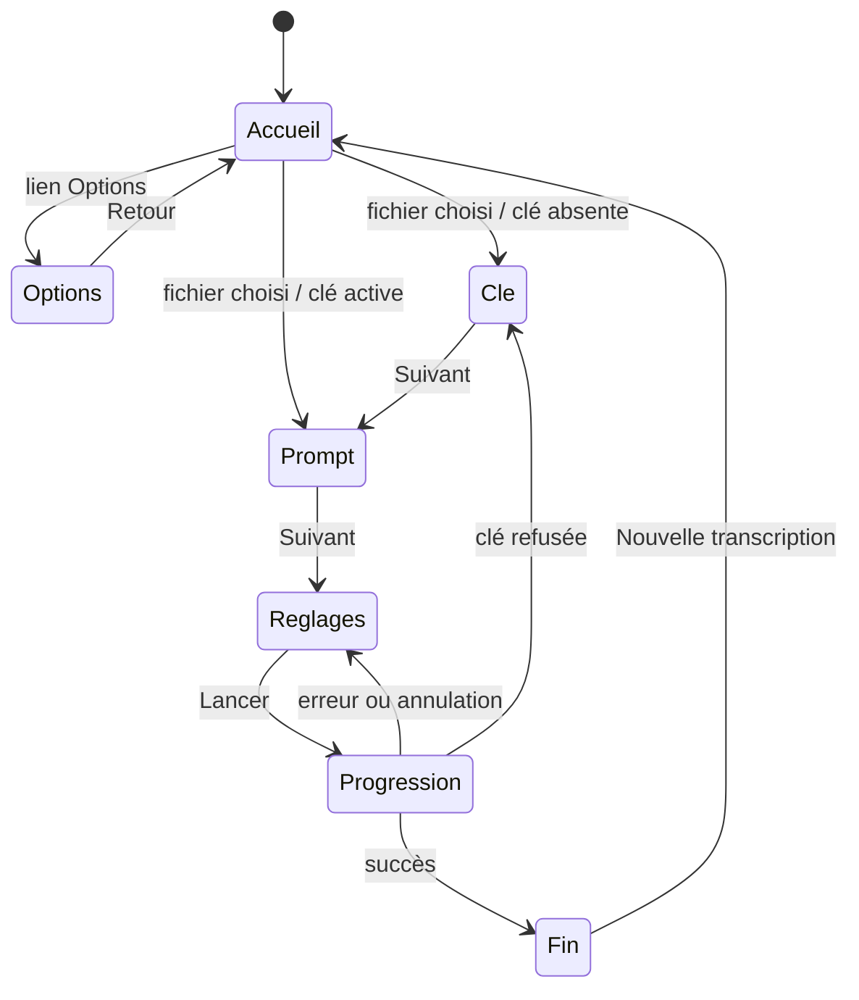
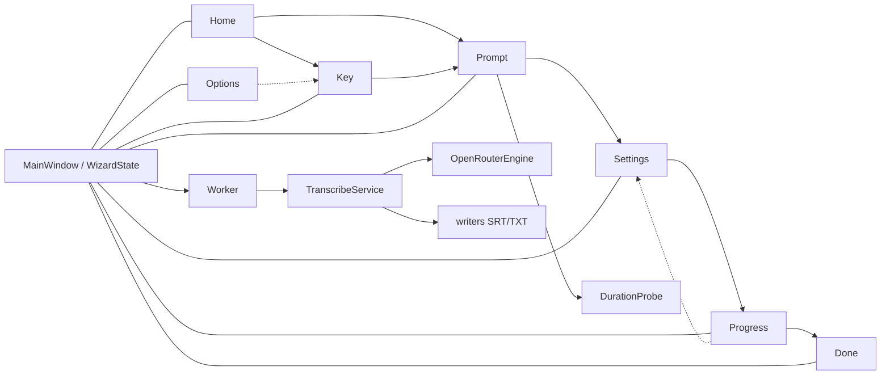

# Spécification — Assistant de transcription et thème inspiré du DSFR

- **Date** : 2026-11-06
- **Statut** : proposée pour revue
- **Version cible** : 0.3.0
- **Périmètre** : refonte de l'interface graphique en assistant à étapes, gestion de la clé, options, thème Qt inspiré du DSFR
- **Hors périmètre** : transcription d'URL, thème officiel DSFR, police Marianne, modifications du cœur, du CLI, des writers ou du packaging

## 1. Contexte

L'interface actuelle (`gui/main_window.py`, 1152 lignes) présente tous les réglages dans une seule page : source, fournisseur, modèle, langue, prompt, sortie, clé, progression, résultat. Elle expose le choix OpenRouter/Whisper et le badge « Édition lite — OpenRouter », ce qui alourdit le parcours et mélange les décisions.

La refonte transforme l'interface en **assistant linéaire** :

1. Accueil : transcrire un fichier, transcrire une URL (indisponible), options.
2. Clé OpenRouter, uniquement si aucune clé active.
3. Fichier et prompt.
4. Réglages de génération.
5. Progression, journal, annulation, erreurs.
6. Fin : fichiers produits, coût, ouverture du dossier.

Les options (clé et à propos) sont une page latérale hors assistant, accessible depuis l'accueil et un bouton engrenage.

Le CLI, le cœur `TranscribeService`, les writers, le packaging et les contrats `TranscribeRequest`/`TranscribeResult` restent inchangés. La GUI reste un adaptateur du même service.

### 1.1 Décisions validées avec l'utilisateur

| Sujet | Décision |
|---|---|
| Fournisseur | **OpenRouter minimal** : aucun sélecteur, aucun badge d'édition ; libellé « Clé OpenRouter » et phrase de confidentialité près de Lancer. |
| Parcours | **6 écrans** avec écran Clé conditionnel. |
| Options | **Accueil + engrenage global** ; page hors assistant. |
| Prompt | **Session seulement** : les modifications ne sont jamais écrites dans le fichier `.prompt.md`. |
| Style | **Inspiré du DSFR**, léger, sans police ni asset officiel. |

## 2. Objectifs

- Réduire la charge cognitive : une décision principale par écran.
- Rendre la clé, le prompt, les réglages et les erreurs compréhensibles sans jargon fournisseur.
- Conserver l'état lors des retours et ne jamais perdre une saisie sans confirmation.
- Afficher une progression et un journal lisibles, avec annulation et reprise.
- Afficher une fin claire : fichiers produits, coût, dossier, nouvelle transcription.
- Supprimer le sélecteur de fournisseur, la mention Whisper et le badge d'édition de l'interface.
- Appliquer un thème Qt léger inspiré du DSFR, en clair et en sombre, sans nouvelle dépendance.
- Préserver les tests sans réseau, sans keyring réel et sans ffprobe réel.

## 3. Non-objectifs

- Transcription d'une URL : carte « Bientôt disponible » seulement.
- Conformité officielle DSFR, utilisation du code DSFR, de la police Marianne/Spectral ou du logo de l'État.
- Thème sombre manuel : le thème suit le réglage système, sans option dans Options.
- Modification des contrats du cœur, du CLI, des writers, des moteurs ou du packaging.
- Traitement par lot, file d'attente, reprise après crash, édition des sous-titres.
- Nouvelle dépendance, nouvelle police embarquée, nouvel asset graphique.
- Traduction de l'interface : français uniquement.

## 4. Décisions de conception

| Décision | Choix | Raison |
|---|---|---|
| Navigation | `QStackedWidget` + contrôleur | état unique, retour déterministe, pages testables |
| Écran Clé | conditionnel | ne pas demander une clé déjà disponible |
| Options | page hors assistant | ce n'est pas une étape de la tâche ; accès permanent |
| Stepper | 4 étapes nommées | orientation sans exposer la numérotation interne |
| Durée | `DurationProbe` asynchrone | ffprobe peut bloquer ; l'invariant UI impose < 100 ms |
| Erreurs de tâche | inline dans Progression | pas de modale, journal et détail au même endroit |
| Confirmation d'écrasement | modale avant Progression | décision destructive ponctuelle |
| Annulation | coopérative | le cœur ne peut pas interrompre une requête HTTP en cours |
| Clé mémorisée | statut + remplacer/supprimer | ne pas recharger un secret dans un champ |
| Prompt | session seulement | ne pas écraser un fichier utilisateur implicitement |
| Journal | toujours visible | le journal est utile pendant et après l'erreur |
| Thème | Fusion + QSS + palette Qt | rendu cohérent multiplateforme, sans dépendance |
| Police | Arial/system | fallback officiel de Marianne, sans embarquement |
| Positionnement DSFR | inspiration originale | le DSFR est réservé à l'administration et aux domaines `.gouv.fr` |
| Livraison | assistant d'abord, thème ensuite | le thème est un bonus non bloquant |

## 5. Parcours et navigation

### 5.1 Machine à états



L'engrenage ouvre la même page Options depuis Accueil, Prompt, Réglages et Progression inactive. Il est masqué sur Clé, Options et Fin, et désactivé pendant l'exécution.

### 5.2 Règles de navigation

- **Historique réel** : le contrôleur empile les pages visitées. Si l'écran Clé a été sauté, `Retour` depuis Prompt revient à Accueil ; il ne crée pas d'écran Clé fantôme.
- **État préservé** : fichier, prompt, durée, clé de session, modèle, langue, formats, dossier et résultat sont conservés lors des retours.
- **Retour depuis Clé** :
  - mode porte initiale : Accueil ;
  - mode correction après clé refusée : Réglages, pour relancer.
- **Retour depuis Options** : page d'origine (Accueil, Prompt, Réglages ou Progression inactive).
- **Retour depuis Progression** : désactivé pendant l'exécution ; après erreur ou annulation, « Retour aux réglages » va à Réglages avec l'état intact, « Accueil » va à Accueil avec le fichier conservé.
- **Fin** : pas de retour vers Progression ; « Nouvelle transcription » réinitialise fichier, prompt, résultat et erreur, conserve réglages et clé.
- **Fermeture pendant une tâche** : confirmation, annulation, attente de la fin du thread, puis fermeture. Pas de `terminate()` de thread.
- **Fermeture avec Options modifiée** : confirmation d'abandon du brouillon de clé.

### 5.3 Stepper

- 4 étapes nommées : **Fichier**, **Prompt**, **Réglages**, **Transcription**.
- L'écran Clé est une porte non numérotée, rattachée visuellement à Fichier.
- Pas de navigation directe par clic.
- Masqué sur Accueil (page d'introduction), Options et Fin (confirmation).
- Affiche le numéro, le titre, l'étape courante et la ligne de progression.
- Accessible : nom « Étape X sur 4 : Titre ».

## 6. Écrans

### 6.1 Accueil

**Contenu**

- Titre « EcoTranscribe Desktop » et sous-titre « Transcrire un fichier audio ou vidéo ».
- Carte fichier principale :
  - sans fichier : titre « Transcrire un fichier », description des formats, bouton primaire « Choisir un fichier » ;
  - avec fichier sélectionné : nom et chemin, bouton primaire « Continuer », bouton secondaire « Changer de fichier ».
  - toute la carte est cliquable et accessible au clavier ;
  - zone de glisser-déposer avec retour visuel au survol.
- Carte URL non interactive : « Transcrire une URL », badge « Bientôt disponible », style atténué, non focusable.
- Lien secondaire « Options ».
- Note discrète si aucune clé active : « Une clé OpenRouter est requise pour transcrire » avec lien vers Options.
- Zone d'erreur inline pour fichier invalide.

**Règles**

- Le dialogue de fichier utilise le filtre audio/vidéo existant et le dernier dossier.
- Un fichier déposé ou choisi est validé (existe, fichier, lisible). En cas d'échec, l'erreur s'affiche sur l'accueil et la sélection précédente est conservée.
- La sélection enregistre `last_input_dir`.
- Le prompt et la durée ne sont pas chargés sur l'accueil.
- Un fichier choisi navigue vers Clé si aucune clé active, sinon vers Prompt.
- Un dépôt est accepté sur Accueil et Prompt. Il est ignoré sur Réglages, Progression, Fin et Options.
- Aucun dépôt n'est accepté pendant une tâche.

### 6.2 Clé OpenRouter

**Contenu**

- Titre « Clé OpenRouter ».
- Explication : « EcoTranscribe utilise OpenRouter pour transcrire. Saisissez votre clé API pour continuer. »
- Lien « Où trouver ma clé ? » vers `https://openrouter.ai/keys` (constante `OPENROUTER_KEYS_URL`).
- Formulaire partagé `KeyForm` :
  - statut de la clé active ;
  - champ mot de passe vide, jamais prérempli avec un secret existant ;
  - case « Mémoriser dans le trousseau » ;
  - note « La clé n'est jamais écrite dans les réglages ni dans le journal. » ;
  - message si le trousseau est indisponible.
- Bouton primaire « Suivant », bouton secondaire « Retour ».
- Zone d'erreur inline.

**Règles**

- L'écran n'est affiché que si aucune clé active (session, trousseau, environnement), ou après une erreur d'authentification.
- `OPENROUTER_API_KEY` compte comme clé active.
- « Suivant » valide un champ non vide.
- Si « Mémoriser » est coché, la clé est écrite dans le trousseau. En cas d'échec, un avertissement inline s'affiche et la clé reste valable pour la session.
- Si « Mémoriser » est décoché, la clé reste en mémoire pour la session.
- Aucun appel réseau de validation de clé.
- En mode correction après refus, le statut « Clé refusée » est affiché et « Suivant » revient aux Réglages.
- Le secret n'est jamais réaffiché, journalisé, stocké dans `QSettings` ou inclus dans un détail d'erreur.

### 6.3 Fichier et prompt

**Contenu**

- Titre « Fichier et prompt ».
- Résumé du fichier :
  - nom ;
  - chemin complet en lecture seule, sélectionnable, avec retour à la ligne ;
  - durée : « Analyse… », `format_seconds(duration_s)` ou « Durée indisponible » ;
  - bouton tertiaire « Changer de fichier ».
- Prompt :
  - libellé « Prompt (optionnel) » ;
  - provenance : « Détecté depuis `<chemin>` », « Aucun fichier prompt détecté » ou avertissement « Prompt illisible » ;
  - zone de saisie directe, multiligne, minimum 200 px, préremplie avec le prompt détecté ;
  - aide : « Contexte, noms propres, vocabulaire, style. Le prompt est optionnel. » ;
  - note : « Les modifications ne sont pas enregistrées dans le fichier. » ;
  - bouton tertiaire « Effacer ».
- Bouton primaire « Suivant », bouton secondaire « Retour ».
- Zone d'erreur inline pour fichier ou prompt.

**Règles**

- La durée est demandée à `DurationProbe` à l'entrée de l'écran et à chaque changement de fichier. Le résultat est ignoré s'il concerne un autre fichier.
- Un échec de ffprobe ou l'absence de ffprobe affiche « Durée indisponible » et ne bloque jamais « Suivant ».
- Le prompt est détecté via `resolve_prompt` (priorité `.prompt.md`, `.prompt.txt`, `.prompt`).
- Une erreur de lecture du prompt est un avertissement non bloquant ; la zone reste éditable.
- Le prompt est optionnel. « Suivant » est autorisé si le fichier est valide.
- Le texte est `strip()`é ; vide = `None`.
- Aucune écriture dans le fichier prompt.
- « Effacer » vide la zone pour la session.
- « Changer de fichier » ouvre le dialogue ; si le prompt a été modifié, une confirmation d'abandon est demandée.
- Après changement de fichier, le prompt est re-détecté et la durée re-analysée.
- Le fichier doit rester valide ; sinon l'erreur s'affiche et « Suivant » est désactivé.

### 6.4 Réglages

**Contenu**

- Titre « Réglages ».
- Section « Modèle et langue » :
  - modèle : combo éditable, modèles récents, identifiants OpenRouter, prix horaire indicatif quand disponible ;
  - langue : Français (défaut), Auto, Anglais, Espagnol, Allemand, Italien, Portugais, Néerlandais.
- Section « Sortie » :
  - cases SRT et TXT, cochées par défaut, au moins une requise ;
  - dossier de sortie avec bouton « Parcourir… » ;
  - aide « Par défaut : dossier du fichier source » quand aucun dossier personnalisé n'est défini ;
  - bouton « Utiliser le dossier de la source » si le dossier mémorisé est invalide.
- Phrase de confidentialité près de l'action : « L'audio est envoyé à OpenRouter pour transcription. Le prompt l'est si le modèle le prend en charge. »
- Bouton primaire « Lancer la transcription », bouton secondaire « Retour ».
- Zones d'erreur inline par champ.

**Règles**

- Validation au clic sur « Lancer », pas de bouton grisé sans explication.
- Erreurs : fichier, dossier de sortie, au moins un format, modèle non vide, clé active.
- Le premier champ invalide reçoit le focus.
- Le dossier par défaut est le dossier du fichier source.
- Un dossier personnalisé valide est conservé lors d'un changement de fichier.
- Un dossier mémorisé invalide affiche une erreur et l'action « Utiliser le dossier de la source ».
- Avant de passer à Progression, `existing_outputs` vérifie les fichiers ; si des fichiers existent, `DialogService.confirm_overwrite` demande « Écraser » ou « Annuler ». Un refus laisse l'utilisateur sur Réglages avec un message neutre.
- Si l'écrasement est accepté, `TranscribeRequest.overwrite=True`.
- Les réglages modèle, langue, formats, dossier et modèle récent sont enregistrés au lancement.
- Les prix sont récupérés de façon asynchrone ; une erreur réseau laisse les identifiants sans prix.
- Aucun sélecteur de fournisseur ni mention d'édition.

### 6.5 Progression

**Contenu**

- Titre « Transcription ».
- Nom du fichier.
- Libellé de phase, barre de progression, temps écoulé, ETA si calculable.
- Journal visible, lecture seule, défilement, maximum 5000 blocs.
- Bouton `danger` « Annuler la transcription ».
- Carte d'erreur inline en haut si échec.
- Carte d'annulation neutre si annulation.
- Bouton « Ouvrir le journal » (fichier `log_file_path()`).

**Progression**

- Barre déterminée si `total` est connu ; sinon indéterminée.
- Pendant l'écriture finale : barre indéterminée, libellé « Écriture des fichiers… », annulation désactivée avec explication.
- Aucune opération bloquante sur le thread UI.

**Annulation**

- L'annulation est coopérative : elle empêche les étapes suivantes et l'écriture, mais peut attendre la fin de la requête HTTP en cours (timeout 90 s).
- L'UI affiche « Annulation en cours… » et ne promet pas un arrêt instantané.
- Pendant l'écriture finale, l'annulation est désactivée ; les writers restent atomiques par fichier.
- Une annulation avant l'écriture ne laisse aucun fichier.
- Une erreur d'écriture peut laisser des fichiers déjà écrits ; le détail les liste.

**Erreur**

- Pas de modale.
- Message utilisateur (`TranscribeError.user_message`), hint si présent, détail technique repliable, journal, bouton « Ouvrir le journal ».
- Actions :
  - « Retour aux réglages » (primaire) ;
  - « Accueil » (tertiaire) ;
  - « Modifier la clé » (secondaire) si l'erreur est une erreur de clé/authentification ;
  - « Changer de fichier » (secondaire) si l'erreur est une erreur de fichier ;
  - « Ouvrir le dossier » (secondaire) si des fichiers ont déjà été écrits.
- Pas de bouton « Réessayer » : le retour aux réglages permet de relancer avec les valeurs conservées.
- L'erreur et le journal ne contiennent jamais la clé.

**Annulation**

- Carte neutre « Transcription annulée. Aucun fichier n'a été écrit. »
- « Retour aux réglages » et « Accueil ».
- Pas de style d'erreur.

**Retour et fermeture**

- Retour désactivé pendant l'exécution ; seule l'annulation est possible.
- Les actions de retour sont activées quand le thread a terminé (`thread.finished`).
- Fermeture pendant l'exécution : confirmation ; si acceptée, annulation, attente de la fin, fermeture.
- Si l'écriture est en cours, l'application attend la fin de l'écriture avant de fermer.

### 6.6 Fin

**Contenu**

- Titre « Transcription terminée ».
- Nom du fichier source.
- Liste des fichiers produits (SRT/TXT), chemins sélectionnables.
- Coût : `$0.000000` avec 6 décimales, ou « Coût indisponible ».
- Bouton primaire « Ouvrir le dossier ».
- Bouton secondaire « Nouvelle transcription ».

**Règles**

- Le coût provient de `TranscribeResult.cost_usd`.
- « Ouvrir le dossier » ouvre le dossier du premier fichier produit ; désactivé si le dossier n'existe plus.
- « Nouvelle transcription » réinitialise fichier, prompt, durée, résultat et erreur ; conserve modèle, langue, formats, dossier, clé et réglages.
- Aucun retour vers Progression.

### 6.7 Options

**Contenu**

- Titre « Options ».
- Section « Clé OpenRouter » :
  - statut : aucune clé, clé de session, clé du trousseau, clé d'environnement ;
  - champ « Nouvelle clé », mot de passe, vide par défaut ;
  - case « Mémoriser dans le trousseau » ;
  - bouton primaire « Enregistrer la clé » ;
  - bouton tertiaire danger « Supprimer la clé » ;
  - lien « Où trouver ma clé ? » ;
  - note de sécurité.
- Section « À propos » :
  - EcoTranscribe Desktop + version ;
  - commit ;
  - date de build ;
  - licence MIT ;
  - URL source cliquable ;
  - mention des notices tierces incluses.
- Bouton secondaire « Retour ».

**Règles**

- « Enregistrer la clé » est désactivé si le champ est vide.
- Si « Mémoriser » est coché, la clé est écrite dans le trousseau ; sinon elle reste en session.
- Le statut et la source active sont mis à jour après enregistrement ou suppression.
- « Supprimer la clé » demande confirmation ; efface la clé du trousseau et la clé de session. Si la seule source est l'environnement, le bouton est désactivé avec la note « Définie par `OPENROUTER_API_KEY` ».
- Une erreur de trousseau est affichée inline ; la clé de session reste utilisable.
- Le secret n'est jamais prérempli ni affiché.
- « Retour » demande confirmation si un brouillon de clé n'est pas enregistré.
- La fermeture de la fenêtre avec un brouillon de clé demande confirmation.
- Aucun réglage de modèle, langue, formats, dossier, thème ou fournisseur dans Options.
- Aucune mention « édition lite », « Whisper » ou sélecteur de fournisseur.
- Le contenu À propos ne mentionne ni édition ni fournisseur.

## 7. État et contrats GUI

### 7.1 `WizardState`

Dataclass GUI interne, mutable, avec `slots=True`. Le contrôleur en est l'unique propriétaire. Les pages chargent et commitent des valeurs ; elles ne conservent pas la vérité métier.

| Champ | Type | Règle |
|---|---|---|
| `input_path` | `Path \| None` | fichier validé |
| `prompt_path` | `Path \| None` | prompt détecté |
| `prompt_text` | `str \| None` | texte édité pour la session |
| `prompt_edited` | `bool` | vrai si l'utilisateur a modifié le prompt |
| `prompt_error` | `str \| None` | avertissement de lecture non bloquant |
| `duration_s` | `float \| None` | durée mesurée |
| `duration_path` | `Path \| None` | fichier associé à la durée |
| `duration_pending` | `bool` | analyse en cours |
| `session_key` | `str \| None` | clé saisie pour la session |
| `key_source` | `KeySource` | source active |
| `model` | `str` | modèle sélectionné |
| `language` | `str \| None` | `None` = Auto |
| `formats` | `frozenset[OutputFormat]` | au moins un |
| `output_dir` | `Path \| None` | dossier de sortie |
| `output_dir_user_set` | `bool` | dossier personnalisé |
| `result` | `TranscribeResult \| None` | succès |
| `error` | `TranscribeError \| None` | échec |
| `cancelled` | `bool` | annulation |
| `options_origin` | `PageId \| None` | retour Options |
| `key_return_page` | `PageId` | retour après Clé |

`KeySource` : `NONE`, `SESSION`, `KEYRING`, `ENV`.

`PageId` : `HOME`, `KEY`, `PROMPT`, `SETTINGS`, `PROGRESS`, `DONE`, `OPTIONS`.

### 7.2 Contrat des pages

Chaque page expose :

- `load(state)` : remplit les widgets depuis l'état ;
- `commit(state) -> bool` : valide et écrit les valeurs dans l'état ;
- `focus_primary()` : place le focus sur le contrôle principal ;
- des signaux `next_requested`, `back_requested`, `options_requested`, `cancel_requested`, `new_transcription_requested`, `open_folder_requested`, `open_log_requested`.

Les messages d'erreur sont affichés dans la page, sous le champ concerné. Le contrôleur n'affiche pas d'erreur de formulaire dans une modale.

### 7.3 Worker

`TranscribeWorker` conserve `progress`, `log`, `finished`, `cancelled`. Le signal `failed` devient `Signal(object)` et transporte l'instance `TranscribeError` complète, avec `user_message`, `hint` et `detail`. Une exception inattendue est encapsulée dans `TranscribeError("La transcription a échoué.", detail=str(exc))`.

### 7.4 `DurationProbe`

- `QObject` avec signaux `ready(Path, float | None)` et `failed(Path, str)`.
- Utilise `get_media_duration` sur un `QThread`, avec `CancelToken`.
- Injecte la fonction de mesure pour les tests.
- Un nouveau fichier annule/invalide la sonde précédente ; un résultat obsolète est ignoré.
- `get_media_duration` absent/échec → `ready(path, None)`, affichage « Durée indisponible ».
- Aucun appel ffprobe réel dans les tests.

### 7.5 Clé et précédence

- Source active : **session > trousseau > environnement**.
- Au démarrage : lire le trousseau une fois (erreur → fallback environnement), lire `OPENROUTER_API_KEY`, mettre à jour `key_source`. Mettre en cache le résultat pour éviter les accès répétés.
- La clé du trousseau/environnement n'est pas chargée dans un champ.
- `session_key` est utilisé pour la requête s'il existe ; sinon le contrôleur résout la clé active au démarrage de l'application et la conserve en cache pour la session.
- Le champ de clé n'est jamais prérempli.
- « Supprimer » efface la clé du trousseau et la clé de session ; si l'environnement est la seule source, l'action est désactivée.
- Une clé refusée ouvre l'écran Clé en mode correction, avec retour vers Réglages.

### 7.6 Persistance

`AppSettings` conserve :

- géométrie ;
- dernier dossier d'entrée ;
- dossier de sortie ;
- modèle ;
- langue ;
- formats ;
- `remember_api_key` ;
- modèles récents.

`AppSettings.log_visible` est supprimé : le journal est toujours visible sur Progression. `EnvStore` est supprimé : la nouvelle résolution lit directement `os.environ` et les tests utilisent `monkeypatch` sur `OPENROUTER_API_KEY`.

Les réglages sont enregistrés au lancement d'une transcription et à la fermeture de la fenêtre. La clé n'est jamais écrite dans `QSettings`.

## 8. Thème inspiré du DSFR

### 8.1 Positionnement et licence

Le DSFR est le système de design de l'État français. Son code est sous licence Etalab 2.0, mais ses [modalités d'utilisation](https://github.com/GouvernementFR/dsfr/blob/main/LICENSE.md) réservent son usage à l'administration et aux domaines `.gouv.fr`, et interdisent un usage trompeur. Il n'est donc **pas** utilisé comme code, composant, police ou asset officiel.

Le thème est une **implémentation QSS originale inspirée** des principes publics du DSFR :

- hiérarchie claire, plat, angles droits, grille de 8 px ;
- palette de référence claire/sombre ;
- boutons primaire/secondaire/tertiaire, formulaires avec libellé au-dessus ;
- indicateur d'étapes, encarts d'alerte, cartes, barre de progression ;
- accessibilité : contraste, focus visible, libellés, hiérarchie.

Aucun fichier CSS, composant, logo, police Marianne/Spectral ou asset DSFR n'est copié ou embarqué. L'application ne se présente pas comme un service de l'État ni comme « conforme DSFR ». Le README peut mentionner « inspiré du DSFR (non officiel) » ; l'interface ne l'affiche pas.

Si l'application est destinée à une administration ou si une conformité DSFR est exigée, les modalités d'utilisation et les polices officielles devront être vérifiées dans un périmètre séparé.

### 8.2 Jetons de couleur

Les valeurs sont dérivées de la palette publique du DSFR ([documentation des couleurs](https://www.systeme-de-design.gouv.fr/version-courante/fr/fondamentaux/couleurs/utilisation-des-couleurs-dans-le-dsfr)). Elles sont centralisées dans `gui/theme.py` ; aucune couleur hexadécimale ne doit apparaître dans les pages.

| Jeton | Clair | Sombre | Usage |
|---|---|---|---|
| `background` | `#FFFFFF` | `#161616` | fond de page |
| `surface` | `#FFFFFF` | `#1E1E1E` | cartes, champs |
| `surface_alt` | `#F6F6F6` | `#242424` | zones secondaires, journal |
| `surface_contrast` | `#EEEEEE` | `#2A2A2A` | survol, piste de progression |
| `text` | `#3A3A3A` | `#CECECE` | corps |
| `text_title` | `#161616` | `#FFFFFF` | titres |
| `text_muted` | `#666666` | `#929292` | aide, mentions |
| `text_disabled` | `#929292` | `#666666` | désactivé |
| `border` | `#DDDDDD` | `#353535` | séparateurs décoratifs |
| `border_strong` | `#3A3A3A` | `#CECECE` | contours de champs |
| `primary` | `#000091` | `#8585F6` | action, lien, focus |
| `primary_hover` | `#1212FF` | `#B1B1F9` | survol |
| `primary_active` | `#2323FF` | `#C6C6FB` | pressé |
| `primary_soft` | `#E3E3FD` | `#272747` | fond secondaire |
| `primary_softest` | `#F5F5FE` | `#1B1B35` | fond très léger |
| `on_primary` | `#F5F5FE` | `#1B1B35` | texte sur primaire |
| `error` | `#CE0500` | `#FF5655` | erreur |
| `error_soft` | `#FFF4F4` | `#391C1C` | fond d'erreur |
| `success` | `#18753C` | `#27A658` | succès |
| `success_soft` | `#DFFEE6` | `#19271D` | fond de succès |
| `warning` | `#B34000` | `#FC5D00` | avertissement |
| `warning_soft` | `#FFF4F3` | `#361E19` | fond d'avertissement |
| `info` | `#0063CB` | `#518FFF` | information |
| `info_soft` | `#F4F6FF` | `#1D2437` | fond d'information |
| `focus` | `#000091` | `#8585F6` | anneau de focus |

Contrastes vérifiés (WCAG 2) :

- texte/fond clair : 11,37:1 ; sombre : 11,50:1 ;
- titres/fond : 18,10:1 ;
- muted/fond : 5,74:1 clair ; 5,82:1 sombre ;
- primaire/on_primary : 13,75:1 clair ; 5,33:1 sombre ;
- erreur/error_soft : 5,35:1 clair ; 4,95:1 sombre ;
- succès/success_soft, warning/warning_soft, info/info_soft : ≥ 4,94:1 ;
- contours forts/fond : ≥ 11,37:1 ;
- focus/fond : ≥ 5,76:1.

### 8.3 Typographie

- Police : `"Arial", "Helvetica Neue", "Liberation Sans", sans-serif`. Arial est le fallback documenté de Marianne dans le DSFR. Aucune police Marianne/Spectral n'est embarquée.
- Échelle adaptée à une fenêtre desktop :
  - titre de page : 28 px, poids 700 ;
  - titre de section : 20 px, poids 700 ;
  - corps : 16 px, poids 400 ;
  - libellé : 14 px, poids 500 ;
  - aide/mention : 12 px, poids 400 ;
  - bouton : 16 px, poids 500 ;
  - journal : 12 px monospace.
- QSS ne gère pas `line-height` : l'espacement est obtenu par les marges de layout et les `QLabel` (24 px corps, 20 px petit).
- Pas de titres bleus non cliquables : les titres utilisent `text_title`, le bleu est réservé aux actions/liens.

### 8.4 Composants

**Boutons**

- Hauteur minimale 40 px, padding 8 px 16 px, rayon 0, bordure 1 px, poids 500.
- `primary` : fond `primary`, texte `on_primary`, survol `primary_hover`, pressé `primary_active`.
- `secondary` : fond `surface`, texte `primary`, bordure `primary`, survol `primary_soft`.
- `tertiary` : fond transparent, texte `primary`, bordure transparente, survol `primary_soft`.
- `danger` : texte `error`, bordure `error`, fond transparent, survol `error_soft` ; extension non officielle du DSFR pour les actions destructives.
- Un seul bouton primaire par écran.
- Libellés d'action explicites et cohérents ; privilégier un verbe (« Choisir un fichier », « Lancer la transcription »). Les libellés de navigation standard (« Retour », « Suivant ») et « Nouvelle transcription » restent acceptés.

**Formulaires**

- Libellé au-dessus du champ, 14 px/500.
- Aide sous le libellé, 12 px, `text_muted`.
- Champ : hauteur 40 px, bordure 1 px `border_strong`, rayon 0, padding 8 px 12 px.
- Focus : bordure 2 px `focus`, padding compensé pour éviter le décalage.
- Erreur : bordure 2 px `error`, message `error` sous le champ.
- Placeholder : `text_muted`, jamais utilisé comme libellé.
- Cases à cocher et boutons radio : indicateurs natifs Fusion, libellés 14-16 px ; pas d'icône personnalisée.
- Combo : même contour, flèche native, liste `surface`/`border`.

**Stepper**

- 4 étapes, numéro dans un cercle de 24 px, titre 14 px.
- Étape courante : cercle plein `primary`, texte `on_primary`, titre `text_title`/700.
- Étape terminée : cercle `primary_soft`, texte `primary`.
- Étape future : cercle `surface_contrast`, texte `text_muted`, titre `text_muted`.
- Ligne de progression 2 px `primary` pour les étapes terminées.
- Pas de clic, pas de navigation directe.
- Masqué sur Accueil, Options et Fin.

**Encarts d'alerte**

- Inspiration des alertes DSFR, pas le composant officiel.
- Bordure gauche 4 px, fond `*_soft`, padding 12-16 px, rayon 0.
- Titre 14-16 px/700, corps 14 px.
- `error` : bordure/texte `error` ; `success` : `success` ; `warning` : `warning` ; `info` : `info`.
- Toujours un titre explicite (« Erreur », « Succès », « Information », « Attention »), pas seulement une couleur/icône.
- Le détail technique est un `QPlainTextEdit` repliable.

**Cartes**

- Bordure 1 px `border`, rayon 0, fond `surface`, padding 16-24 px.
- Pas d'ombre.
- Carte cliquable : bordure `primary` au survol/focus, curseur main, accessible au clavier.
- Carte désactivée : fond `surface_alt`, texte `text_disabled`, non focusable.

**Badge**

- 12 px, fond `primary_soft`, texte `primary`, rayon 0, padding 2 px 6 px.

**Barre de progression**

- Hauteur 8 px, rayon 0, piste `surface_contrast`, remplissage `primary`.
- Texte de barre masqué ; le pourcentage est dans le libellé de phase.

**Journal**

- `QPlainTextEdit` lecture seule, monospace 12 px, fond `surface_alt`, bordure 1 px `border`, rayon 0, padding 8 px.
- Maximum 5000 blocs, défilement automatique.

**Liens**

- `primary`, soulignés, via `QPalette.Link` et le rendu rich text.
- Focus visible.

**En-tête, barre d'action**

- En-tête : fond `background`, bordure basse 1 px `border`, titre 20-24 px/700, engrenage tertiaire.
- Barre d'action : fond `background`, bordure haute 1 px `border`, padding 16 px, secondaire à gauche, primaire à droite.
- Page : fond `background`, contenu centré, largeur maximale 720 px, marges 32 px.
- Fenêtre : minimum 760 × 640, taille par défaut 900 × 820.

**Dialogue**

- Les `QMessageBox` de confirmation héritent des couleurs et boutons du thème.
- Le dialogue de fichiers reste natif.
- Une seule action primaire par modale ; l'action destructive par défaut est « Annuler ».

### 8.5 API du thème

`gui/theme.py` :

```python
@dataclass(frozen=True, slots=True)
class ThemeTokens:
    background: str
    surface: str
    surface_alt: str
    # ... tous les jetons ci-dessus

LIGHT = ThemeTokens(...)
DARK = ThemeTokens(...)

def stylesheet(tokens: ThemeTokens) -> str: ...
def apply_theme(app: QApplication, scheme: Qt.ColorScheme | None = None) -> None: ...

class ThemeManager(QObject):
    def __init__(self, app: QApplication) -> None: ...
    def apply(self) -> None: ...
```

`apply_theme` :

1. `app.setStyle("Fusion")` ;
2. choisit `LIGHT`/`DARK` selon `QGuiApplication.styleHints().colorScheme()` ou le schéma fourni ;
3. construit et applique un `QPalette` (Window, Base, Text, Button, Highlight, Link, PlaceholderText, ToolTip, Disabled) ;
4. applique `stylesheet(tokens)`.

`ThemeManager` écoute `QGuiApplication.styleHints().colorSchemeChanged` et réapplique le thème.

Helpers :

```python
def set_variant(widget: QWidget, value: str) -> None: ...
def set_role(widget: QWidget, value: str) -> None: ...
def set_severity(widget: QWidget, value: str) -> None: ...
def set_state(widget: QWidget, value: str) -> None: ...
```

Ils posent une propriété dynamique, puis `unpolish`/`polish` et `update`.

Sélecteurs QSS basés sur les propriétés :

- `QPushButton[variant="primary"]`, `secondary`, `tertiary`, `danger` ;
- `QLabel[role="pageTitle"]`, `sectionTitle`, `muted`, `mention`, `error`, `success`, `badge` ;
- `QFrame[role="card"]`, `[role="alert"][severity="error"]`, `[role="privacy"]` ;
- `QLineEdit[state="error"]`, `QComboBox[state="error"]`, `QPlainTextEdit[state="error"]` ;
- `QPlainTextEdit[role="log"]` ;
- `QProgressBar[role="transcription"]`.

`app.py` applique `apply_theme(app)` avant de construire `MainWindow`. Les tests n'appliquent pas le thème ; ils testent le comportement. La vérification visuelle est manuelle.

### 8.6 Poids et livraison

- Un module `gui/theme.py` (jetons + QSS + palette + manager), environ 250-350 lignes.
- Aucune dépendance, aucun asset, aucune police, aucun fichier CSS externe.
- Le thème est la **phase 2** du plan, après l'assistant fonctionnel.
- Le thème ne doit pas modifier la logique de navigation, de validation ou de worker.
- Si le thème révèle des régressions visuelles, l'assistant reste fonctionnel et le thème est ajusté sans changer les contrats.
- Vérification visuelle : clair/sombre, toutes les pages, focus clavier, boutons désactivés, erreurs, succès, annulation, journal, dialogues.

### 8.7 Accessibilité

- Contraste texte ≥ 4,5:1 ; grands textes ≥ 3:1 ; contours/focus ≥ 3:1.
- Focus visible sur tous les contrôles interactifs.
- Libellés associés aux champs (`setBuddy`), textes d'aide, messages d'erreur explicites.
- Pas de dépendance à la couleur seule : les encarts ont un titre.
- Navigation clavier complète ; ordre de tabulation cohérent.
- Touche Entrée : action primaire ; Ctrl/Cmd+Entrée : suivant/lancer ; Échap : retour ou annulation ; dans le prompt, Entrée = nouvelle ligne.
- Le thème ne prétend pas à une conformité RGAA/DSFR formelle ; les vérifications sont documentées.

## 9. Architecture

### 9.1 Arborescence GUI cible

```text
src/ecotranscribe/gui/
├── __init__.py
├── app.py                     # QApplication, thème, MainWindow
├── main_window.py             # shell/contrôleur : header, stepper, stack, routing, worker
├── state.py                   # WizardState, KeySource, PageId
├── duration.py                # DurationProbe
├── theme.py                   # jetons, palette, QSS, ThemeManager
├── worker.py                  # signal failed typé
├── settings.py                # AppSettings sans log_visible
├── dialogs.py                 # confirmations uniquement
├── pricing.py                 # inchangé
├── availability.py            # diagnostic inchangé
├── logging_setup.py           # inchangé
├── pages/
│   ├── __init__.py
│   ├── home.py
│   ├── key.py
│   ├── prompt.py
│   ├── settings.py
│   ├── progress.py
│   ├── done.py
│   └── options.py
└── widgets/
    ├── __init__.py
    ├── key_form.py            # formulaire partagé Clé/Options
    ├── stepper.py             # indicateur 4 étapes
    ├── alerts.py              # encart d'alerte
    ├── cards.py               # carte cliquable, carte désactivée
    └── layout.py              # page, barre d'action, section
```

`main_window.py` devient le shell/contrôleur. Il conserve la signature publique du constructeur :

```python
MainWindow(
    *,
    settings: AppSettings,
    key_store: KeyStore,
    dialogs: DialogService,
    service_factory: Callable[[TranscribeRequest], TranscribeService] | None = None,
    pricing_client: PricingClient | None = None,
    duration_probe: DurationProbe | None = None,
    parent: QWidget | None = None,
)
```

`app.py` passe le client de tarifs réel et la sonde de durée réelle par défaut.

### 9.2 Responsabilités

| Module | Responsabilité |
|---|---|
| `main_window.py` | shell, header, stepper, stack, historique, validation globale, worker/thread, settings, close/drop, raccourcis |
| `state.py` | état unique de l'assistant |
| `pages/home.py` | choix/dépôt de fichier, cartes accueil |
| `pages/key.py` | porte Clé, modes initial/correction |
| `pages/prompt.py` | résumé fichier, durée, prompt |
| `pages/settings.py` | modèle, langue, formats, dossier, confidentialité |
| `pages/progress.py` | progression, journal, annulation, erreur |
| `pages/done.py` | succès, fichiers, coût, dossier |
| `pages/options.py` | clé et à propos |
| `widgets/key_form.py` | formulaire de clé partagé |
| `widgets/stepper.py` | indicateur d'étapes |
| `widgets/alerts.py` | encart d'alerte |
| `widgets/cards.py` | cartes cliquables/désactivées |
| `theme.py` | jetons et QSS, aucun comportement |
| `duration.py` | sonde ffprobe asynchrone |
| `worker.py` | exécution du service, signaux |
| `settings.py` | persistance QSettings |
| `dialogs.py` | confirmations modales |

### 9.3 Flux



Le cœur, le CLI, les writers et le packaging ne changent pas. Seul le signal d'échec du worker GUI change.

## 10. Exigences fonctionnelles

| ID | Priorité | Exigence |
|---|---|---|
| FR-01 | MUST | L'application démarre sur Accueil avec les choix fichier, URL désactivée et Options. |
| FR-02 | MUST | Un fichier peut être choisi par dialogue ou glisser-déposer ; il est validé avant navigation. |
| FR-03 | MUST | L'écran Clé n'apparaît que si aucune clé active ; il gère session, trousseau, environnement, mémorisation et erreurs. |
| FR-04 | MUST | Le secret mémorisé n'est jamais prérempli dans un champ. |
| FR-05 | MUST | L'écran Fichier/prompt affiche le chemin, la durée asynchrone et un prompt éditable directement. |
| FR-06 | MUST | Le prompt est auto-détecté, optionnel, session-only, effaçable, et son erreur de lecture ne bloque pas. |
| FR-07 | MUST | L'écran Réglages gère modèle, langue, SRT/TXT, dossier de sortie, validation inline et confidentialité. |
| FR-08 | MUST | L'écrasement est confirmé avant Progression ; un refus ne modifie rien. |
| FR-09 | MUST | Progression affiche phase, barre, temps, ETA, journal et annulation. |
| FR-10 | MUST | Les erreurs de tâche sont inline, avec message, hint, détail, journal et retour ; pas de modale. |
| FR-11 | MUST | L'annulation est coopérative, affiche « Annulation en cours… », et ne laisse aucun fichier avant l'écriture. |
| FR-12 | MUST | L'annulation est désactivée pendant l'écriture finale ; une erreur d'écriture liste les fichiers déjà produits. |
| FR-13 | MUST | Fin affiche les fichiers produits, le coût (ou « indisponible »), « Ouvrir le dossier » et « Nouvelle transcription ». |
| FR-14 | MUST | Options est accessible depuis Accueil et l'engrenage, et contient la clé et l'à propos. |
| FR-15 | MUST | Le stepper a 4 étapes, n'est pas cliquable, et est masqué sur Accueil, Options et Fin. |
| FR-16 | MUST | Le retour suit l'historique réel et préserve l'état ; le changement de fichier confirmé réinitialise le prompt. |
| FR-17 | MUST | Le clavier suit les règles Entrée / Ctrl-Cmd+Entrée / Échap ; le focus est géré. |
| FR-18 | MUST | Le sélecteur de fournisseur, Whisper et le badge d'édition sont retirés de l'interface. |
| FR-19 | MUST | « Clé OpenRouter » et la phrase de confidentialité restent visibles ; les messages du cœur ne sont pas réécrits. |
| FR-20 | MUST | Options À propos affiche version, commit, build, licence, source et notices, sans édition ni fournisseur. |
| FR-21 | MUST | Le thème Qt inspiré du DSFR est appliqué en clair et sombre, sans asset/police officiel. |
| FR-22 | MUST | Les réglages non secrets sont persistés ; `log_visible` est supprimé ; le journal est toujours visible. |
| FR-23 | MUST | La clé n'apparaît jamais dans `QSettings`, les logs ou les détails d'erreur. |
| FR-24 | MUST | Le cœur, le CLI, les writers et le packaging restent inchangés. |
| FR-25 | SHOULD | Le thème est livré après l'assistant fonctionnel, sans bloquer la navigation. |

## 11. Exigences non fonctionnelles

| ID | Exigence |
|---|---|
| NFR-01 | Aucune opération > 100 ms sur le thread UI : durée, tarifs et transcription sont hors thread. |
| NFR-02 | Une seule transcription à la fois ; un second lancement est impossible. |
| NFR-03 | Annulation réseau au plus tard à la fin de la requête en cours (timeout 90 s), avec message explicite. |
| NFR-04 | Les writers restent atomiques par fichier ; aucune annulation pendant l'écriture finale. |
| NFR-05 | Sécurité : HTTPS/TLS standard, clé jamais loguée/persistée en clair, aucun secret dans les erreurs. |
| NFR-06 | Accessibilité : labels, focus visible, contrastes, navigation clavier, pas de couleur seule. |
| NFR-07 | Thème léger : un module, aucune dépendance, aucun asset, aucune police embarquée. |
| NFR-08 | DSFR : inspiration originale, aucun code/asset/logo/police officiel, aucune revendication de conformité. |
| NFR-09 | Interface en français ; identifiants et code en anglais. |
| NFR-10 | Chemins avec espaces, accents et caractères non ASCII pris en charge. |
| NFR-11 | Tests sans réseau, sans keyring réel, sans ffprobe réel ; fakes injectés. |
| NFR-12 | Démarrage à froid ≤ 5 s ; pas de régression de performance. |
| NFR-13 | Aucune télémétrie, aucun rapport de crash distant, aucune vérification de mise à jour. |
| NFR-14 | Maintenabilité : pages/widgets découpés, fichiers de page < 400 lignes lorsque c'est raisonnable, contrôleur documenté, pas de code mort. |
| NFR-15 | Contrastes du thème vérifiés automatiquement : texte ≥ 4,5:1, UI/focus ≥ 3:1. |
| NFR-16 | Le dialogue de fichiers reste natif ; les autres dialogues sont thémés. |
| NFR-17 | Aucun artefact généré, secret ou fichier `uv.lock` modifié dans le diff. |

## 12. Tests

### 12.1 Matrice

| Zone | Cas |
|---|---|
| Navigation | sans clé → Clé → Prompt ; avec clé → Prompt ; retour arrière réel ; Options depuis Accueil/engrenage ; engrenage désactivé pendant l'exécution ; fermeture pendant l'exécution |
| Accueil | dialogue, drop, fichier invalide, fichier sélectionné Continuer/Changer, URL non focusable, note sans clé |
| Clé | pas de préremplissage, statut, mémoriser coché/décoché, échec keyring, source env, clé refusée → retour Réglages, champ vide |
| Prompt | auto-détection, édition, effacement, session-only, changement de fichier avec confirmation, erreur de lecture non bloquante |
| Durée | succès, échec ffprobe, résultat obsolète ignoré, « Suivant » non bloqué |
| Réglages | défauts, modèle/prix, modèle personnalisé, langue Auto, formats, dossier par défaut, dossier invalide → source, validation inline, écrasement accepté/refusé, phrase de confidentialité |
| Progression | phases, barre déterminée/indéterminée, ETA, journal, annulation, écriture non annulable, erreur avec hint/détail/journal, carte annulation, retour |
| Fin | fichiers produits, coût/indisponible, ouverture du dossier, nouvelle transcription |
| Options | statut, enregistrement, suppression confirmée, source env non supprimable, à propos, brouillon non enregistré |
| Sécurité | clé absente de `QSettings`, du journal et des détails d'erreur |
| Persistance | géométrie, dossiers, modèle, langue, formats, remember, modèles récents ; `log_visible` absent |
| Thème | contrastes clair/sombre ; aucune couleur hexadécimale dans les pages (revue) ; vérification visuelle manuelle |
| Worker | failed transporte `TranscribeError` avec hint ; cancelled ; unexpected exception encapsulée |

### 12.2 Règles

- Faux `DurationProbe`, faux `PricingClient`, faux service, `MemoryStore`, `QSettings` temporaire.
- Aucun appel réseau, aucun keyring réel, aucun ffprobe réel.
- Tests GUI avec `QT_QPA_PLATFORM=offscreen` si nécessaire.
- Le test de contraste importe `LIGHT`/`DARK` et calcule le ratio WCAG ; il ne teste pas le texte QSS.
- La vérification visuelle du thème est manuelle (clair/sombre, focus, erreurs, désactivés, journal).
- Les tests cœur/CLI existants doivent continuer à passer.
- La suite complète `uv run pytest` est lancée avant livraison.

### 12.3 Vérification manuelle

- `uv run ecotranscribe-desktop` : parcours complet sans clé, puis avec clé mémorisée (Clé sautée).
- Options depuis Accueil et engrenage ; enregistrer/supprimer une clé.
- Prompt détecté, modifié, effacé ; changement de fichier.
- Durée affichée ou « Durée indisponible ».
- Écrasement accepté/refusé.
- Progression, annulation, erreur simulée, retour.
- Fin, ouverture du dossier, nouvelle transcription.
- Thème clair/sombre système, focus clavier, contrastes.
- `uv run ecotranscribe --help` et un parcours CLI inchangé.

## 13. Documentation, version et livraison

- Version **0.3.0** alignée dans `pyproject.toml` et `src/ecotranscribe/__init__.py`.
- Entrée datée dans `CHANGELOG.md` : assistant, options, clé, thème inspiré du DSFR, suppression du sélecteur fournisseur/édition lite.
- `README.md` : section interface mise à jour, parcours, clé, thème « inspiré du DSFR (non officiel) », absence de police/assets officiels.
- `docs/install-macos-unsigned.md`, `docs/distribution.md`, `THIRD_PARTY_NOTICES.md` : inchangés, sauf mention nécessaire.
- Aucun changement de packaging, de ffmpeg, de `uv.lock` ou de dépendance.
- Spec : `docs/superpowers/specs/2026-11-06-wizard-ui-design.md`.
- Plan : `docs/superpowers/plans/2026-11-06-wizard-ui.md` (à créer après revue de la spec).

## 14. Critères d'acceptation

- [ ] Parcours complet sans clé : Accueil → Clé → Prompt → Réglages → Progression → Fin.
- [ ] Parcours avec clé mémorisée : Clé sautée, Accueil → Prompt → Réglages → Progression → Fin.
- [ ] Clé refusée : erreur inline, « Modifier la clé », retour Réglages, relance possible.
- [ ] Options accessible depuis Accueil et l'engrenage ; enregistrement/suppression de clé ; à propos sans édition/fournisseur.
- [ ] Prompt auto-détecté, éditable directement, session-only, effaçable ; changement de fichier confirmé.
- [ ] Durée asynchrone, jamais bloquante ; « Durée indisponible » si ffprobe échoue.
- [ ] Validation inline ; écrasement confirmé ; refus sans modification.
- [ ] Progression, journal, annulation ; annulation désactivée pendant l'écriture ; erreur inline avec hint/détail/journal.
- [ ] Fin avec fichiers produits, coût ou « indisponible », ouverture du dossier, nouvelle transcription.
- [ ] Retour réel, état préservé, fermeture pendant tâche confirmée.
- [ ] Aucun sélecteur de fournisseur, mention Whisper ou badge d'édition dans l'interface.
- [ ] « Clé OpenRouter » et phrase de confidentialité présentes ; aucune réécriture des messages du cœur.
- [ ] Thème inspiré du DSFR en clair/sombre, sans asset/police officiel ; contrastes vérifiés.
- [ ] Aucune couleur hexadécimale dans les pages ; jetons centralisés.
- [ ] Clé absente de `QSettings`, des logs et des détails d'erreur.
- [ ] `uv run pytest` passe ; vérification manuelle effectuée ; aucun artefact généré.
- [ ] `README.md`, `CHANGELOG.md` et version 0.3.0 mis à jour.

## 15. Risques et limites

| Risque | Mitigation |
|---|---|
| Le thème QSS/Fusion régresse visuellement | phase séparée, vérification manuelle clair/sombre, retrait possible sans impact fonctionnel |
| Le DSFR est réservé à l'administration | inspiration originale, aucun asset officiel, aucune revendication ; revue légale si usage administratif |
| La police Arial n'est pas disponible sur Linux | fallback `Liberation Sans`/sans-serif ; pas de police embarquée |
| L'annulation réseau peut prendre jusqu'à 90 s | message explicite, pas de kill de thread, aucun fichier partiel |
| Le keyring peut demander une autorisation système | lecture unique au démarrage, mise en cache, pas d'accès répété |
| ffprobe est absent ou échoue | « Durée indisponible », « Suivant » non bloqué |
| La refonte casse les tests GUI existants | réécriture autour des pages/contrôleur, fakes injectés |
| `log_visible` disparaît | journal toujours visible ; changement documenté |
| Le dossier mémorisé n'existe plus | erreur inline et action « Utiliser le dossier de la source » |
| Le brouillon de clé est perdu | confirmation sur Retour et fermeture |
| Le prompt édité est perdu au changement de fichier | confirmation d'abandon |
| La QSS ne gère pas `line-height`/`outline-offset` | espacement par layout, focus par bordure compensée |

## 16. Références

- DSFR — couleurs et tokens de décision : <https://www.systeme-de-design.gouv.fr/version-courante/fr/fondamentaux/couleurs/utilisation-des-couleurs-dans-le-dsfr>
- DSFR — typographie : <https://www.systeme-de-design.gouv.fr/version-courante/fr/fondamentaux/typographie>
- DSFR — bouton : <https://www.systeme-de-design.gouv.fr/version-courante/fr/composants/bouton>
- DSFR — champ de saisie : <https://www.systeme-de-design.gouv.fr/version-courante/fr/composants/champ-de-saisie>
- DSFR — indicateur d'étapes : <https://www.systeme-de-design.gouv.fr/version-courante/fr/composants/indicateur-d-etapes>
- DSFR — alerte : <https://www.systeme-de-design.gouv.fr/version-courante/fr/composants/alerte>
- DSFR — carte : <https://www.systeme-de-design.gouv.fr/version-courante/fr/composants/carte>
- DSFR — dépôt officiel : <https://github.com/GouvernementFR/dsfr>
- DSFR — licence et modalités d'utilisation : <https://github.com/GouvernementFR/dsfr/blob/main/LICENSE.md>
- DSFR — palette de référence (SCSS) : <https://github.com/GouvernementFR/dsfr/blob/main/src/module/color/variable/_options.scss>
- Spécification existante : `docs/superpowers/specs/2026-11-05-desktop-lite-design.md`
- Règles du dépôt : `AGENTS.md`

## 17. Questions ouvertes

Aucune question bloquante. Les décisions validées sont consignées en section 1.1. Le seul point de vigilance est le positionnement DSFR : l'application n'est pas un service de l'État et le thème reste une inspiration non officielle. Si ce positionnement change, la spec devra être révisée avant de réutiliser des assets officiels.
